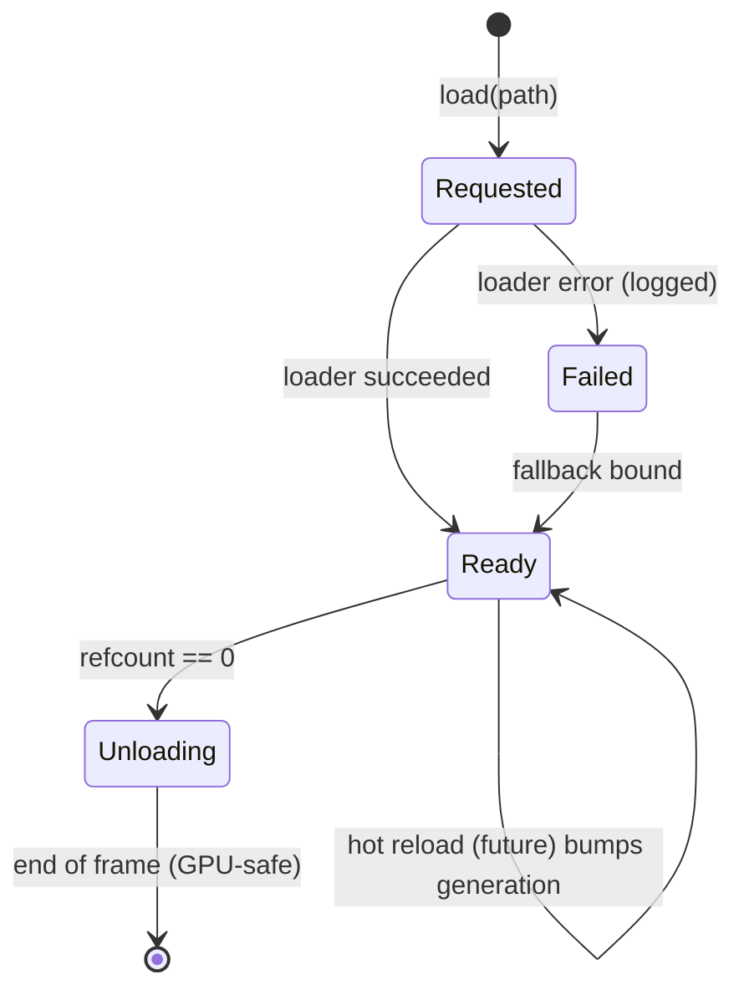

# Asset system

The asset system (`teserra_assets`, layer 2) identifies, loads, caches and releases assets. It knows files and CPU-side data; GPU-resident asset types are produced by loaders that the **renderer** registers. v1 keeps the system deliberately small.

Related: [ADR-0010 stb_image](../adr/0010-stb-image-decoding.md), [ADR-0020 handles](../adr/0020-generational-handles.md), [renderer](renderer.md#materials-shaders-and-uniforms), [platform](platform-abstraction.md).

## Scope

| v1 (v0.1) | Future |
|---|---|
| `AssetId` from virtual paths, typed handles with reference counting | Stable GUIDs in sidecar `.meta` files (editor renames) |
| Synchronous loading on the main thread | Async loading on a job system with load states |
| Loader registry by asset type and file extension | Dependency graph (material → textures) with batched loading |
| Virtual mount points (`assets://`, `engine://`) | Packed archives for shipping, mod mount points |
| Fallback assets for missing/failed loads | Hot reload via file watching |
| Asset types: `ImageData` (CPU), `Texture`, `Shader`, `Material`, `SpriteSheet`, `Tileset`, `TilemapData` | Meshes, audio clips, fonts, animations, prefabs |
| Source formats loaded directly (PNG, `.tshader`, Tiled `.tmj` JSON) | Offline importer/cooker to runtime formats (KTX2/BasisU textures, binary maps) |

## Handles and IDs

```cpp
// Stable identity: 64-bit hash of the normalized virtual path.
AssetId id = AssetId::fromPath("assets://sprites/hero.png");

// Typed, reference-counted handle. Copying shares ownership; the asset unloads when the
// last handle is gone (deferred to the end of the frame).
Asset<Texture> hero = assets.load<Texture>("assets://sprites/hero.png");

if (hero.isReady()) { /* use */ }
const Texture& tex = hero.get();         // asserts if not ready
```

- **`AssetId`** is the persistent identity (what scenes and maps store). In v1 it is the FNV-1a hash of the normalized virtual path (lowercase scheme, forward slashes, no `..`). The registry keeps the reverse map and **asserts on hash collisions** in debug builds.
- **`Asset<T>`** is the runtime handle: a generational slot handle plus a reference count in the registry's slot (non-atomic in v1 because loading is single-threaded; atomic when async loading arrives).
- **Unloading** happens at the end of the frame for slots whose count reached zero, after the renderer's deferred destruction rules for GPU objects.
- Loading the same path twice returns the same slot.
- **Today** (`<teserra/assets/asset_id.hpp>`, `<teserra/assets/asset_registry.hpp>`, #80): `AssetId::fromPath()` and `normalizeAssetPath()`; `AssetRegistry::load<T>(path, create)`, where `create` returns `Result<T>` and runs only when the path is not loaded yet, and `endFrame()`; `Asset<T>` with `isReady()`, `get()` and `id()`. A failed `create` is logged once with the path and leaves a slot that is not ready, deduplicated like a loaded one, so a missing file logs one error. `create` may load other assets (dependencies); an asset that loads itself asserts. Unloading an asset releases the assets it holds, and the same `endFrame()` unloads those too. Slot types are checked in debug builds through the address of a per-type tag variable, which needs no RTTI and no `ecs::TypeKey`. The registry must outlive its `Asset<T>`s (asserted when it is destroyed). `load<T>(path)` with registered loaders (#81) will read the bytes through the mount points (`MountTable`, #82) and pass the loader to the same path.

## Loaders

```cpp
template <typename T>
class AssetLoader {
public:
    virtual ~AssetLoader() = default;
    virtual std::span<const std::string_view> extensions() const = 0;
    virtual Result<T> load(AssetLoadContext& ctx, std::span<const std::byte> bytes) = 0;
};
```

- Loaders are registered per type: `assets.registerLoader<Texture>(std::make_unique<TextureLoader>(device))`. The **renderer** registers `Texture`, `Shader` and `Material` loaders (it owns the `rhi::Device`), the **scene** layer registers `Tileset` and `TilemapData` loaders. The asset module itself only provides `ImageData` (stb_image).
- `AssetLoadContext` provides file access through mount points, the ability to load dependencies (`ctx.load<Texture>(path)`), and the asset's import settings (sRGB, filtering, `pixelsPerUnit`) from an optional sidecar `<file>.asset.json` (v1: optional, defaults apply).
- Loaders return `Result<T>`. A failure is logged once with the path, and the handle resolves to a **fallback asset** (magenta/black checkerboard texture, error shader, empty tileset), so a missing file never crashes a game in development.
- **Today** (`<teserra/assets/asset_registry.hpp>`, #81): `AssetLoader<T>`, `AssetLoadContext` (`path()`, `load<T>()` for dependencies, `readFile()` for other files) and `AssetRegistry::registerLoader<T>()` / `load<T>(path)`.
  - The loader is chosen by the asset type and the path's extension, compared without case; extensions are registered lowercase and without the dot, and two loaders of one type cannot claim the same one. `.png` can be an `ImageData` and a `Texture`, because the type is part of the key. Loaders are stored type-erased, so a new asset type (a mesh) needs only its loader.
  - `load<T>(path)` reads the file through the registry's `MountTable` (`AssetRegistryConfig::mounts`) and goes through `load<T>(path, create)`, so deduplication and the single error log with the path work the same for both. A type without a loader for the extension, and a registry without a mount table, fail with `Unsupported`.
  - `assets::ImageLoader` makes `ImageData` from `.png` files. The renderer's `<teserra/renderer/assets.hpp>` has `renderer::Texture` (an `Rgba8Srgb` texture with one mip level, named after its path) with `TextureLoader` (`.png`), and `renderer::Shader` (a shader module and its stage) with `ShaderLoader` (`.tshader`); `renderer::registerAssetLoaders(registry, device)` registers both. Both asset types own their GPU object and destroy it when they unload; the device keeps it until no frame in flight uses it.
  - `engine::App` owns the registry (`app.assets()`), reading through `app.mounts()`, with `ImageLoader` and, when it has a device, the renderer's loaders. It calls `endFrame()` after each frame, and it is destroyed after the scenes and before the device.
  - Not yet: the `<file>.asset.json` sidecar, which needs the JSON library of #90 (#228), so every asset loads with defaults.

### Fallback assets

A failed load (missing file, broken data, no loader) resolves to the **fallback** of its type, so the game shows something obviously wrong instead of crashing or drawing nothing (#83):

```cpp
registry.setFallback(std::move(checkerboard));               // every failed Texture
registry.setFallback(std::move(errorVertex), ".vert.tshader"); // failed Shaders whose path ends so
Asset<Texture> hero = registry.load<Texture>("assets://missing.png");
hero.isReady();     // true: get() returns the fallback
hero.isFallback();  // true; isLoaded() is false
```

- Fallbacks are registered per type with `AssetRegistry::setFallback<T>(fallback, pathSuffix)`, created once at startup and owned by the registry until it is destroyed. A path suffix (compared without case) lets one type have several: the longest matching suffix wins, and `""` matches every path. Failed slots that exist already are bound when a fallback is added.
- `isReady()` means "`get()` may be called": the asset loaded or a fallback is bound. `isLoaded()` and `isFallback()` tell them apart. A failed load of a type without a fallback is not ready, and `get()` asserts.
- The error is still logged once per failed load, with the path, so a game that keeps its handle logs one error for a missing file.
- The renderer's `registerAssetLoaders()` creates its fallbacks: an 8×8 `Rgba8Srgb` texture of magenta and black 4×4 checks (magenta at the top left), an error vertex shader for `.vert.tshader` paths (no inputs, its triangles are empty) and an error fragment shader for `.frag.tshader` paths (opaque magenta, no inputs or bindings). `teserra_add_shaders()` names blobs after their sources, so the stage is in the path; other shader paths have no fallback.

## Sprite sheets

A sprite sheet names rectangular regions of one texture (`renderer::SpriteSheet`, `<teserra/renderer/sprite_sheet.hpp>`, #84). The renderer owns it because it holds an `Asset<Texture>`, which keeps the texture loaded while the sheet lives.

```cpp
Asset<Texture> texture = app.assets().load<Texture>("assets://sprites.png");
SpriteSheet sheet = *SpriteSheet::grid(texture, {.cellSize = {16, 16}, .namePrefix = "hero"});
level.add<SpriteRenderer>(hero, scene::spriteFromSheet(sheet, *sheet.find("hero3")));
```

- **Regions** (`SpriteRegion`) are a name, a top-left texel and a size in texels, with the origin at the texture's top-left corner ([ADR-0024](../adr/0024-coordinate-conventions.md)); `regionUv(textureSize, position, size)` turns them into `UvRect`s. Region indices follow the order of the regions, and `find(name)` looks one up.
- **Grids** (`SpriteSheet::grid(texture, SpriteGrid)`): cells of `cellSize` after a `margin`, with `spacing` between them, row by row from the top left, named `<namePrefix><index>`. `count` limits the cells, and 0 takes every cell that fits whole. A zero cell size or more cells than fit are `InvalidArgument`, and a texture that is not ready is `NotFound`.
- **World size:** `worldSize(region)` is the region's texels divided by the sheet's `pixelsPerUnit` (default 16, `kDefaultPixelsPerUnit`), so 16-pixel art fills one world unit.
- **Missing textures:** when the texture is a fallback, every region shows the whole fallback (`uv()` is the full texture), and a grid makes the `count` cells asked for (at least one), so a game whose sheet file is missing still runs and logs one error.
- **Sprites:** `scene::spriteFromSheet(sheet, region)` (or by name) makes a `SpriteRenderer` with the region's texture, UVs and world size. `SpriteRenderer` stores the texture's `rhi::TextureHandle`, so the game keeps the sheet alive while sprites show it.
- **Not yet:** sheets defined in a `.sheet.json` file (grid or named regions) need the JSON library of #90 (#231). Until then sheets are made in code, and the registry can share one with `load<SpriteSheet>(path, create)`.

## Image decoding

`decodeImage(bytes, config)` (`<teserra/assets/image.hpp>`) turns a PNG file in memory into an `ImageData`: width, height, `ImageFormat::Rgba8` and tightly packed pixels, with row 0 as the top row of the file ([ADR-0024](../adr/0024-coordinate-conventions.md)). The texture loader builds on it.

- **Formats:** PNG only in v1. Grayscale, RGB, palette and 16-bit images are converted to RGBA8, and images without alpha get an alpha of 255. JPEG or TGA would each be one stb define plus a test.
- **Color space** is not part of `ImageData`: the loader's import settings decide whether a texture is `Rgba8Srgb` or `Rgba8Unorm` ([ADR-0010](../adr/0010-stb-image-decoding.md)).
- **Limits:** `ImageDecodeConfig::maxDimension` (default 16384 pixels per side, the smallest `MAX_TEXTURE_SIZE` that OpenGL 4.5 allows) and `maxSizeInBytes` (default 256 MiB) are checked against the header before anything is decoded or allocated. An image over either limit is `Unsupported`; empty, malformed, truncated and non-PNG data is `InvalidData`.
- **stb_image** is private to `teserra_assets` and compiled in one translation unit: with `STB_IMAGE_STATIC`, so a game can compile its own copy; without file access; with `TESERRA_ASSERT` for its assertions; and with its allocations going through `operator new`, so they count like the engine's own.
- **Trust:** asset files are trusted developer content in v1. stb_image is not hardened against hostile files ([SECURITY.md](../../SECURITY.md)).

## Mount points and files

- Virtual paths: `assets://` maps to the game's asset directory (default `<executable dir>/assets`), `engine://` to the engine's built-in assets (default `<executable dir>/engine`). Mounts are configured in `AppConfig::mounts`.
- All file access goes through `platform::FileSystem`; loaders receive bytes, not paths. This keeps archives and hot reload possible later without touching loaders.
- A virtual path is `<scheme>://<relative path>`. The scheme is a letter followed by letters, digits, `-` or `_`, compared without case. The relative path uses `/` (`\` counts as `/`), and every component is a name: **empty components, `.` and `..` are rejected, not collapsed**, so a path cannot leave its mount and each file has one spelling, and therefore one `AssetId`. `:` is rejected after the scheme, so drive letters and Windows stream names never reach the file system. Names keep their case, because Linux file systems are case-sensitive.

```cpp
assets::MountTable& mounts = app.mounts();
mounts.resolve("assets://sprites/hero.png");   // "<executable dir>/assets/sprites/hero.png"
mounts.readFile("assets://sprites/hero.png");  // Result<std::vector<std::byte>>
mounts.resolve("assets://../save.dat");         // InvalidArgument
```

- **Today** (`<teserra/assets/mount_table.hpp>`, #82): `MountTable` with `mount()`, `unmount()`, `directory()`, `resolve()` and `readFile()`, whose errors name the virtual path; a scheme without a mount is `NotFound`. `engine::App` owns one on the platform's file system (`app.mounts()`): `AppConfig::mounts` (`{scheme, directory}`) adds schemes or replaces the defaults, a relative directory is relative to the executable's directory, and initialization fails if a listed directory does not exist or a scheme is invalid or listed twice. The default directories may be missing, so a game without files still starts. Built-in engine assets (the sprite shaders) are still embedded in the renderer, so `engine://` has nothing to read yet.

## Importing vs runtime formats

v1 loads **source formats** directly to keep the pipeline small: PNG via stb_image, shaders as `.tshader` produced at build time ([ADR-0017](../adr/0017-shader-pipeline.md)), Tiled maps as JSON. This is fine for 2D and for v0.1 load times. The future cooker converts sources into runtime formats in a build step without changing the runtime API, because loaders are selected by asset type and extension.

## Lifetime diagram



## Future

- **Hot reload:** a platform file watcher marks assets dirty; the registry reloads them in place and bumps the slot's version so dependents (materials, pipelines) refresh. Required for the editor.
- **Async loading:** `load()` returns immediately with `isReady() == false`; loaders run on worker threads; GPU uploads are finalized on the main thread.
- **GUIDs and `.meta` files:** needed once the editor can rename/move assets.
- **Cooker:** offline conversion, texture compression, atlas packing, binary tilemaps, archive packing.
