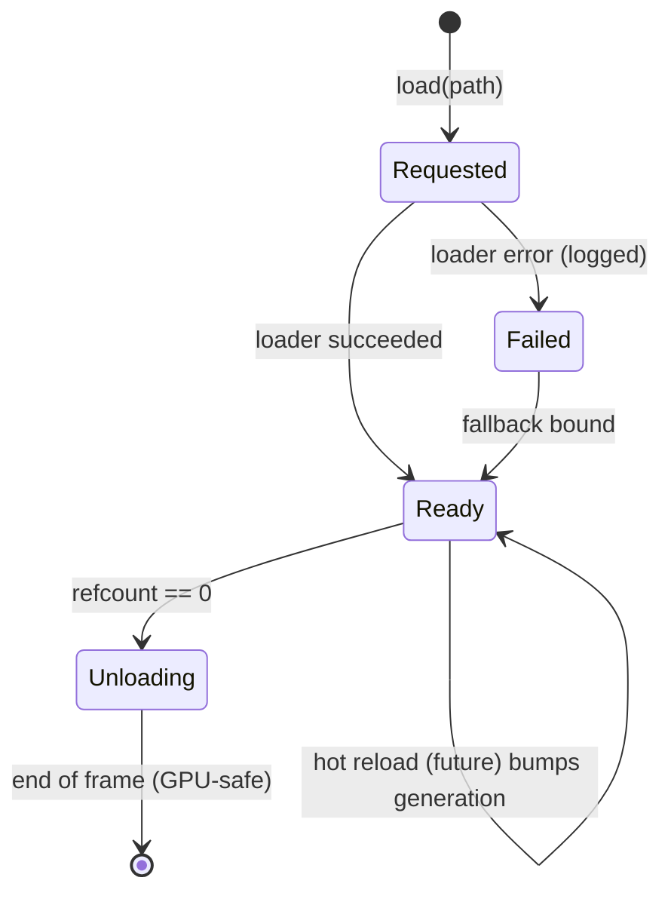

# Asset system

The asset system (`teserra_assets`, layer 2) identifies, loads, caches and releases assets. It knows files and CPU-side data; GPU-resident asset types are produced by loaders that the **renderer** registers. v1 keeps the system deliberately small.

Related: [ADR-0010 stb_image](../adr/0010-stb-image-decoding.md), [ADR-0020 handles](../adr/0020-generational-handles.md), [renderer](renderer.md#materials-shaders-and-uniforms), [platform](platform-abstraction.md).

## Scope

| v1 (v0.1) | Future |
|---|---|
| `AssetId` from virtual paths, typed handles with reference counting | Stable GUIDs in sidecar `.meta` files (editor renames) |
| Synchronous loading on the main thread | Async loading on a job system with load states |
| Loader registry by asset type and file extension | Dependency graph (material → textures) with batched loading |
| Virtual mount points (`assets://`, `engine://`) | Packed archives for shipping, mod mount points |
| Fallback assets for missing/failed loads | Hot reload via file watching |
| Asset types: `ImageData` (CPU), `Texture`, `Shader`, `Material`, `SpriteSheet`, `Tileset`, `TilemapData` | Meshes, audio clips, fonts, animations, prefabs |
| Source formats loaded directly (PNG, `.tshader`, Tiled `.tmj` JSON) | Offline importer/cooker to runtime formats (KTX2/BasisU textures, binary maps) |

## Handles and IDs

```cpp
// Stable identity: 64-bit hash of the normalized virtual path.
AssetId id = AssetId::fromPath("assets://sprites/hero.png");

// Typed, reference-counted handle. Copying shares ownership; the asset unloads when the
// last handle is gone (deferred to the end of the frame).
Asset<Texture> hero = assets.load<Texture>("assets://sprites/hero.png");

if (hero.isReady()) { /* use */ }
const Texture& tex = assets.get(hero);   // asserts if not ready
```

- **`AssetId`** is the persistent identity (what scenes and maps store). In v1 it is the FNV-1a hash of the normalized virtual path (lowercase scheme, forward slashes, no `..`). The registry keeps the reverse map and **asserts on hash collisions** in debug builds.
- **`Asset<T>`** is the runtime handle: a generational slot handle plus a reference count in the registry's slot (non-atomic in v1 because loading is single-threaded; atomic when async loading arrives).
- **Unloading** happens at the end of the frame for slots whose count reached zero, after the renderer's deferred destruction rules for GPU objects.
- Loading the same path twice returns the same slot.

## Loaders

```cpp
template <typename T>
class AssetLoader {
public:
    virtual ~AssetLoader() = default;
    virtual std::span<const std::string_view> extensions() const = 0;
    virtual Result<T> load(AssetLoadContext& ctx, std::span<const std::byte> bytes) = 0;
};
```

- Loaders are registered per type: `assets.registerLoader<Texture>(std::make_unique<TextureLoader>(device))`. The **renderer** registers `Texture`, `Shader` and `Material` loaders (it owns the `rhi::Device`), the **scene** layer registers `Tileset` and `TilemapData` loaders. The asset module itself only provides `ImageData` (stb_image).
- `AssetLoadContext` provides file access through mount points, the ability to load dependencies (`ctx.load<Texture>(path)`), and the asset's import settings (sRGB, filtering, `pixelsPerUnit`) from an optional sidecar `<file>.asset.json` (v1: optional, defaults apply).
- Loaders return `Result<T>`. A failure is logged once with the path, and the handle resolves to a **fallback asset** (magenta/black checkerboard texture, error shader, empty tileset), so a missing file never crashes a game in development.

## Mount points and files

- Virtual paths: `assets://` maps to the game's asset directory (default `<executable dir>/assets`), `engine://` to the engine's built-in assets. Mounts are configured in `AppConfig`.
- All file access goes through `platform::FileSystem`; loaders receive bytes, not paths. This keeps archives and hot reload possible later without touching loaders.

## Importing vs runtime formats

v1 loads **source formats** directly to keep the pipeline small: PNG via stb_image, shaders as `.tshader` produced at build time ([ADR-0017](../adr/0017-shader-pipeline.md)), Tiled maps as JSON. This is fine for 2D and for v0.1 load times. The future cooker converts sources into runtime formats in a build step without changing the runtime API, because loaders are selected by asset type and extension.

## Lifetime diagram



## Future

- **Hot reload:** a platform file watcher marks assets dirty; the registry reloads them in place and bumps the slot's version so dependents (materials, pipelines) refresh. Required for the editor.
- **Async loading:** `load()` returns immediately with `isReady() == false`; loaders run on worker threads; GPU uploads are finalized on the main thread.
- **GUIDs and `.meta` files:** needed once the editor can rename/move assets.
- **Cooker:** offline conversion, texture compression, atlas packing, binary tilemaps, archive packing.
