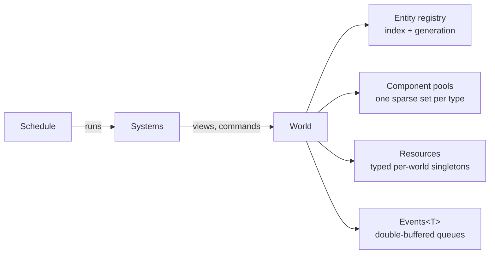
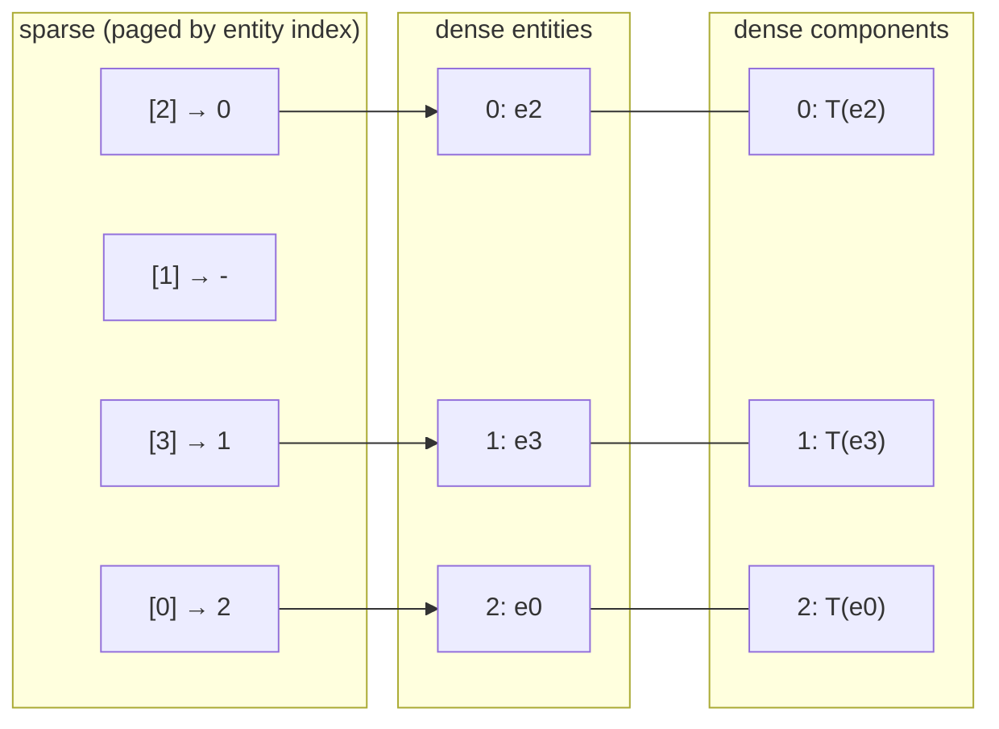

# Entity Component System

Teserra's ECS (`teserra_ecs`, layer 4) is written from scratch ([ADR-0007](../adr/0007-custom-ecs.md)) using sparse-set storage ([ADR-0019](../adr/0019-ecs-storage-sparse-sets.md)). It depends only on `teserra_core`; it knows nothing about rendering, assets or windows. The scene layer (`teserra_scene`) builds on it.

## Scope

| v1 (v0.1) | Future |
|---|---|
| `World`, generational `Entity`, sparse-set pools, multi-component views with exclusion | Owning groups / sorted pools (benchmark-driven) |
| Deferred structural changes (`Commands`) | Component add/remove hooks (observers) |
| Per-world resources and double-buffered events | Relations (parent/child as first-class ECS feature) |
| `Schedule` with phases, ordering constraints, declared data access, single-threaded execution | Parallel executor using declared access |
| Component metadata (name, size, alignment, lifecycle, optional fields) | Serialization, prefabs, editor inspection, scripting bindings |

## Concepts



- **World:** owns entities, component pools, resources and event queues. Several worlds can coexist (tests, editor previews). Entities never move between worlds.
- **Entity:** `ecs::Entity`, a generational handle ([ADR-0020](../adr/0020-generational-handles.md)): 32-bit index + 32-bit generation. Null entity = default-constructed.
- **Component:** any C++ type that is move-constructible and destructible. No base class, no virtuals. Empty types are **tags** and store no data.
- **View:** iteration over all entities that have a set of components (and optionally lack others).
- **System:** a callable taking `SystemContext&`, registered in a `Schedule` with a name, phase, ordering and declared data access.
- **Resource:** a typed per-world singleton (`Time`, `Input` snapshot, `Gravity`), the replacement for global variables.
- **Event:** typed message queues for decoupled communication (`CollisionStarted`, `PlayerDied`).

## Entities

- The registry stores one `u32 generation` per index and a FIFO free list of indices.
- `create()` pops a free index (or appends) and returns `{index, generation}`. Live generations start at 1.
- `destroy(e)` removes all of the entity's components, increments the generation and enqueues the index. Destroying a stale entity is a programmer error (assert); `isAlive(e)` checks without asserting.
- v1 destroys by asking each pool to remove the entity (O(number of pools)). A per-entity component bitmask is a planned optimization if benchmarks show it matters.
- `World` (`<teserra/ecs/world.hpp>`): `create()`, `destroy(e)`, `isAlive(e)`, `entityCount()` and `forEachEntity(f)` over the live entities in index order. `ecs::Entity` (`<teserra/ecs/entity.hpp>`) is `Handle<EntityTag>`, and the registry is core's `HandlePool` (FIFO reuse, generations from 1, an index retired at the maximum generation instead of wrapping). `create()` and `destroy()` assert while `forEachEntity()` runs: structural changes during iteration go through `Commands`.

## Component storage

Each component type has a `ComponentPool<T>`, a sparse set:



- **Sparse** array: entity index → dense index, allocated in pages (4096 entries) on demand, so rare components do not allocate the full index range.
- **Dense** arrays: entities and components packed contiguously in the same order. Single-component iteration is a linear walk.
- **Add:** append to dense arrays, write sparse entry. **Remove:** swap the last element into the hole, pop, fix the moved entity's sparse entry (swap-and-pop). Both O(1).
- Membership checks also compare the stored entity's generation, so stale entities never match.
- Pointers/references to components are valid until the next structural change **of that pool**. Code must not hold component pointers across frames; hold the `Entity` instead.
- Iteration order is unspecified and changes after removals.
- `ComponentPool<T>` (`<teserra/ecs/component_pool.hpp>`): `add`, `remove`, `has`, `get`, `tryGet`, and `entities()` / `components()` spans in dense order. **Tags** (empty types) keep only their entities: no component array, no `get`. `lock()` returns an RAII `ComponentPoolBase::Lock`; adding or removing while one lives asserts (views take one). `allocatedPages()` reports the sparse pages in use.
- `World` component API: `add<T>(e, args...)` (returns `T&`; nothing for tags), `remove<T>(e)`, `has<T>(e)`, `get<T>(e)`, `tryGet<T>(e)`, `pool<T>()` (created on first use) and `tryPool<T>()`. Adding a component the entity has, removing or getting one it lacks, or using a dead entity asserts. `destroy(e)` removes the entity from every pool. Pools are kept in a vector sorted by `TypeKey` (a world has a few dozen types, and views cache their pools), which keeps `World`'s move `noexcept`.

### Component types and metadata

```cpp
struct Velocity { Vec3 value; };
struct Enemy {};                       // tag

TESERRA_COMPONENT(Velocity, "Velocity");  // optional explicit registration with a stable name, at global scope
```

- Each component type has a `TypeKey` (`<teserra/ecs/type_key.hpp>`): the 64-bit FNV-1a hash of a stable type name (explicit name if registered through `ComponentName<T>::kName`, otherwise the compiler's spelling from `std::source_location` without `struct ` / `class ` / `enum `, namespaces kept). A golden test pins `typeKey("Velocity")`. Register the name of anything that is saved or sent: compilers may spell templates differently. TypeKeys are stable across builds and across shared-library boundaries (no reliance on static counters or RTTI).
- The world maps `TypeKey` → pool. Views cache pool pointers once at creation, so iteration never hashes.
- `ComponentMeta` (`componentMeta<T>()`, `<teserra/ecs/component_meta.hpp>`) records key, name, size, alignment, whether the type is a tag, and type-erased move-construct and destroy functions. Optional **field descriptors** (`name`, `offset`, `FieldType`) are registered by specializing `ComponentFields<T>` with `static constexpr std::array<FieldDescriptor, N> kFields`. v1 does not consume them yet; they exist so that serialization, the editor inspector and scripting bindings can be added without changing component definitions ([ADR-0014](../adr/0014-scripting-deferred.md)).

## Views

```cpp
// All entities with Transform and Velocity, but not Frozen
for (auto [entity, transform, velocity] : world.view<Transform, const Velocity>(exclude<Frozen>)) {
    transform.position += velocity.value * dt;
}

world.each<Transform, const Velocity>([dt](Entity, Transform& t, const Velocity& v) {
    t.position += v.value * dt;
});
```

- A view iterates the **smallest** included pool and checks membership in the others and non-membership in excluded pools.
- `const` component types in the view express read-only access (used by access validation).
- **No structural changes during iteration** to pools touched by the view. Debug builds keep an iteration lock count per pool and assert on add/remove/destroy while locked. Use `Commands` instead.
- `World::view<Included...>(exclude<Excluded...>)` returns a `View` (`<teserra/ecs/view.hpp>`). Each element is a `std::tuple<Entity, Included&...>` for structured bindings; a `const` type gives a `const&`, so writing to it does not compile; a tag in the included list binds to a shared empty object. The view picks its smallest included pool as leader when it is created, holds a `ComponentPoolBase::Lock` on every included and excluded pool for its lifetime, and is neither copyable nor movable. It creates missing pools up front, so iteration never looks them up, and iterating allocates nothing. `each(f)` calls `f(entity, components...)`.
- `examples/ecs_sandbox` (console) creates 100 000 entities and prints the time of creating them, of views with two and three components and with an exclusion, of `each()`, and of removing and destroying.

## Structural changes: Commands

```cpp
void spawnBullets(SystemContext& ctx) {
    for (auto [e, gun, transform] : ctx.view<Gun, const Transform>()) {
        if (gun.cooldown <= 0.0f) {
            Entity bullet = ctx.commands().create();
            ctx.commands().add<Transform>(bullet, transform);
            ctx.commands().add<Velocity>(bullet, {gun.direction * gun.muzzleSpeed});
            gun.cooldown = gun.fireInterval;
        }
    }
}
```

- `Commands` records creates, destroys, adds and removes into a reused buffer. Entities created through commands get reserved IDs immediately (usable in the same buffer).
- Commands are applied at **sync points**: after each schedule phase, in recording order. This makes structural changes deterministic.
- `ecs::Commands` (`<teserra/ecs/commands.hpp>`) records for one World; until the Schedule exists, the caller calls `apply()`. Each applied command has the checks of the World call it makes (adding twice, removing what is missing, destroying a dead entity, a pool locked by a view all assert); recording asserts that the entity is alive or reserved.
- **Reserved entities:** `create()` returns the entity `World::create()` would have, from the same free list, marked pending. It is not alive (`isAlive()`, `entityCount()` and `forEachEntity()` skip it) until the buffer is applied; `clear()` or destroying the buffer releases it with a new generation. Reserving is allowed during `forEachEntity()`, where `World::create()` is not.
- **Storage:** records in a vector, and components constructed at record time in 16 KiB chunks that never move (so `std::string` and other types that are not trivially relocatable stay valid), aligned to 64 bytes at most. Both are kept between applies: recording and applying allocate nothing in steady state.

## Resources and events

- `world.insertResource<T>(value)`, `world.resource<T>()`, `world.tryResource<T>()`. Engine services exposed to gameplay (time, input state, asset registry access, debug draw) are resources or members of `SystemContext`, never globals.
- Resources (`World::insertResource`, `resource`, `tryResource`, `hasResource`, `removeResource`) can be any object type that is not cv-qualified, movable or not: they are constructed in place and never move, so references stay valid until the resource is removed. They are named and keyed like components. A missing resource, or inserting one twice, asserts with the type name. The World destroys its resources in reverse insertion order, before its entities and components; move-assigning a World over another does the same for the old one.
- `Events<T>` is double-buffered: events sent in frame N can be read during frames N and N+1, then are dropped. Each reader keeps a cursor, so several systems can read the same events once each.
  - **Today** (`<teserra/ecs/events.hpp>`, #99): `Events<T>` is a resource. `send()` appends; `update()` starts the next frame (the previous frame's events are dropped, this frame's become the previous); `read(cursor, f)` calls `f(const T&)` for every event the `EventCursor` has not seen, oldest first, and moves it on. Events get increasing ids, so a reader that misses a frame still gets what is left, and buffers keep their capacity, so a steady-state frame allocates nothing.
  - `addEvents<T>(world)` inserts `Events<T>` once and registers it in the world's `EventRegistry`, and `updateEvents(world)` updates every registered type. A `Scene` does that at the start of every PreUpdate (`scene.addEvents<T>()`), so events sent anywhere in frame N, from Startup to Last, are readable through frame N+1.
  - In a schedule, `.sendsEvents<T>()` and `.readsEvents<T>()` declare the access (as `writesResource`/`readsResource` of `Events<T>`). `ctx.sendEvent(event)` sends; `ctx.readEvents<T>(f)` reads with the system's own cursor, which the schedule keeps per system and event type. Two readers each see every event once, whichever runs first.

## Systems and scheduling

```cpp
void movePlayer(ecs::SystemContext& ctx) {
    const f32 dt = ctx.resource<const scene::Time>().deltaSeconds();
    for (auto [entity, transform, player] : ctx.view<scene::Transform, const Player>()) { ... }
}

level.systems().add(ecs::Phase::Update, "move_player", movePlayer)
    .reads<Player>().writes<scene::Transform>().readsResource<scene::Time>()
    .after("input_mapping");
```

- `ecs::Schedule` (`<teserra/ecs/schedule.hpp>`) holds systems grouped by **phase**: `Startup`, `PreUpdate`, `FixedUpdate`, `Update`, `PostUpdate`, `Extract` (render extraction), `Last`. The enum lives in `ecs` next to the Schedule; the scene layer and the App decide when each phase runs.
- A system is a plain callable, `std::function<void(SystemContext&)>`, with a name unique in the schedule. It allocates at registration only, never per frame, and a future script-defined system registers the same way.
- **Ordering:** within a phase, systems run in registration order, adjusted by `before(name)` / `after(name)`: a topological sort that always picks the earliest registered ready system, so unconstrained systems keep their order. `build()` returns an `Error` for a cycle (naming two systems on it: "Systems 'a' and 'b' form an ordering cycle in Update") and for a constraint on a system that is not in the same phase. `run()` builds when systems were added; a build error asserts, and with asserts off it is logged and the phase runs in registration order.
- **Declared access** is mandatory: `reads<T>()`, `writes<T>()` (implies reads), `readsResource<T>()`, `writesResource<T>()`. The system's `SystemContext` (`<teserra/ecs/system_context.hpp>`) checks every access in debug builds:
  - `view<const T>()` and excluded types need a read, `view<T>()` a write;
  - `resource<const T>()` needs a resource read, `resource<T>()` a write;
  - a failure asserts naming the system, the type and the missing declaration: "System 'move' reads Velocity without declaring it (.reads<Velocity>())".
  The declarations are kept in every build: v1 executes systems **sequentially** on the main thread, and they are the contract a future parallel executor relies on.
- **Sync points:** the Schedule owns one `Commands` for the World it runs. Every system of a phase records into `ctx.commands()`, and the buffer is applied after the phase, so structural changes never happen in the middle of one and every system of a phase sees the same entities.
- `FixedUpdate` runs zero or more times per frame from the fixed-step accumulator (platform `Clock` + engine loop); its commands apply after each step.
- Events, run conditions and the parallel executor come later. Time and input are resources (`scene::Time`), not `SystemContext` members: the context lives in `ecs`, which cannot see scene or platform types.

## Scenes own worlds

- `scene::Scene` owns one `ecs::World`, one `ecs::Schedule`, and scene-level resources (in its World).
- `scene::SceneManager` (owned by `App`) holds the active scene and switches scenes **at frame boundaries** (never in the middle of a schedule).
- Today (`teserra_scene`, layer 5, iteration 10):
  - `Scene` owns its `ecs::World` and has `spawn()` and `add<T>()` shortcuts. Every scene's World has a `scene::Time` resource: `deltaSeconds()`, `fixedStepSeconds()`, and `elapsedSeconds()` and `frame()` while the scene was active.
  - `App::scenes()` creates scenes (unique names, stable references) and `App::run(scene)` activates one before the first frame.
  - `scenes().switchTo(other)` takes effect at the start of the next frame, wherever in a frame it is called.
  - The App advances the active scene's `Time` once per frame, so each scene keeps its own play time.
  - `Scene::systems()` is the scene's Schedule, and `Scene::run(phase)` runs a phase on its world; Startup runs only the first time.
  - Each frame the App runs the active scene's phases, with the `AppCallbacks` next to them: frame boundary (switch; Startup the first frame a scene is active) → events → `Time` advances → PreUpdate → FixedUpdate × steps → Update → PostUpdate → Extract → render → Last.
  - The module depends only on `core` and `ecs`, so the portable Linux build includes it.
  - **Transforms are 3D** (renderer.md, 3D readiness #1):
    - `scene::Transform` is `Vec3 position`, `Quat rotation`, `Vec3 scale`; `matrix()` is translate × rotate × scale.
    - 2D helpers work in the XY plane and keep z: `position2D` / `setPosition2D`, `rotation2D` / `setRotation2D` (radians, counter-clockwise around +Z, in (-π, π], ADR-0024), `scale2D` / `setScale2D`.
    - The transform system (`scene::transformSystem`, named `scene::kTransformSystemName` = `"teserra.transforms"`) runs in every scene's PostUpdate: it sets every `GlobalTransform` (`Mat4`) from its `Transform`, and gives entities without one a `GlobalTransform` with the right matrix through commands, so it exists after PostUpdate's sync point and is correct for Extract. Children follow their parents ([transform hierarchies](#transform-hierarchies)). Order gameplay systems that move things in PostUpdate with `.before(scene::kTransformSystemName)`.
    - `scene::updateGlobalTransforms(world)` does the same directly on a World, outside a Schedule.
  - **Input:** the App keeps a `platform::Input` resource in the active scene's World, inserted the first frame and set after the events of every frame. Systems read it with `.readsResource<platform::Input>()`.
  - **Rendering** (with the renderer; the portable build leaves these headers out, `OPTIONAL_DEPENDS renderer`):
    - `scene::Camera` is `renderer::Camera` used as a component, and `scene::SpriteRenderer` holds the fields of a `SpriteDrawItem` except the world matrix, plus `visible` (`<teserra/scene/render_components.hpp>`).
    - Every scene has a `scene::RenderExtraction` resource and the extraction system (`scene::kRenderExtractionSystemName` = `"teserra.render_extraction"`, Extract). It refills the resource's `FramePacket`: a view per entity with a `Camera` and a `GlobalTransform`, and a `SpriteDrawItem` per visible `SpriteRenderer` whose 3D bounds (`spriteBounds()`) intersect a view's bounds (`viewBounds()`, the frustum corners through `inverseViewProjection`). Culled sprites are counted in `culledSprites`. Nothing is extracted while `targetSize` is zero. With a chunk mesh cache (`chunkMeshes`, set by the App), it also adds the visible chunks of every `Tilemap` with a `TilemapRenderer`, rebuilding only changed ones ([renderer.md: tilemaps](renderer.md#tilemaps)); for that it writes `Tilemap` (dirty flags).
    - The App sets `targetSize` before Extract to the size of its renderer's scene target (the swapchain's size, or a fixed resolution: [renderer.md: render targets](renderer.md#render-targets)), and `renderer`, through which cameras with a `target` get their target's size; cameras whose target is missing are left out. Without a render callback, it renders the packet with `App::renderer()`, created the first time it is needed. With a render callback, `targetSize` is the swapchain's size and `renderer` is null.
    - A steady-state Extract allocates nothing (tested with 10 000 sprites), and so does a whole App frame of a rendered scene.
    - `Transform` describes its fields for the editor (`ComponentFields`).
- Engine-provided systems (transform propagation, render extraction, tilemap chunk updates) are added to every scene by the engine; games add their own.

### Collision

Simple, robust collision without a physics engine (`<teserra/scene/collision.hpp>`, #103):

- **`Collider { Vec2 size; Vec2 offset; }`**: an axis-aligned box in world units, centered on the entity's world position plus `offset`. Rotation and scale do not change it. `colliderBounds(collider, position)` gives its `Aabb`.
- **Against tiles:** `moveAgainstTiles(query, layer, isSolid, box, delta)` moves a box along x, then y. Each axis sweeps the whole path through `TilemapQuery::tilesOverlapping`, so no speed tunnels (tested at 50 tiles per frame). The box stops flush against the first solid tile ahead, and `MoveResult` says how far it moved and on which axes it hit. A box resting on a floor slides freely, and one that starts inside a wall can leave it. The map must not be rotated.
- **Between entities:** the collision system (`kCollisionSystemName` = `"teserra.collisions"`, PostUpdate after the transforms) finds overlapping pairs by sort and sweep along x. It sends `CollisionStarted {a, b}` for new pairs and `CollisionEnded {a, b}` for pairs that stopped overlapping, including when an entity died or lost its collider (`a` has the lower id; `other(self)` gives the entity `self` collided with, #251). Boxes that only touch do not overlap. Every scene registers both event types; the pairs of the last update are in the `CollisionState` resource, and a steady-state update allocates nothing.
- **Debug drawing:** with the renderer, the `CollisionDebug` resource (off by default) makes `"teserra.collision_debug"` outline every collider in the scene's `DebugDrawList`, in another color while it overlaps something.

### Transform hierarchies

A weapon in a hand, a turret on a ship: `<teserra/scene/hierarchy.hpp>` (#98).

- **`Parent { Entity entity; }`** is the truth. A child's `Transform` is relative to its parent's world matrix; changing `Parent::entity` reparents. `setParent(world, child, parent)` sets it and asserts that both are alive and that no cycle forms. `removeParent(world, child)` detaches. In systems, `commands().add<Parent>(child, Parent{parent})` works too.
- **`Children { std::vector<Entity> entities; }`** is derived: `setParent()` and `removeParent()` update it at once, and the transform system makes it follow the `Parent` components every PostUpdate. Read it, do not write it.
- **Propagation** happens in the transform system, with full 3D matrices (3D readiness #1):
  - roots get their local matrix;
  - children are sorted by depth (walking up their `Parent` chain, at most `kMaxHierarchyDepth` = 1024 levels, deeper is a cycle and asserts) and get `parent world × local`, so every parent is done before its children whatever the storage order;
  - a parent whose `GlobalTransform` is still a pending command is computed from its chain of local transforms;
  - an entity without a `Transform` in the middle of a chain counts as identity.
- **Destruction:** an entity whose parent, or any ancestor, is no longer alive is destroyed through commands. Destroying a parent (directly or through commands) destroys its whole subtree at the next PostUpdate's sync point.
- **Memory:** the system's scratch (`TransformHierarchyScratch`) is a resource of every scene, so a steady-state PostUpdate allocates nothing. `SystemContext::tryGet<T>(entity)`, `has<T>(entity)` (tags included, #247) and `isAlive(entity)` give systems checked random access, such as a child reading its parent or a collision reader testing the other entity for a tag.

## Roadmap: from simple and correct to benchmarked and optimized

| Stage | Content | Exit criterion |
|---|---|---|
| 1. Correct (v0.1, iteration "Custom ECS core") | Registry, sparse-set pools, views, exclusion, tests incl. randomized comparison against a naive reference model | All invariants covered by tests; ASan clean |
| 2. Usable (v0.1, iteration "Scene, transforms and systems") | Commands, resources, events, schedule with declared access, scenes | Demo game written without touching ECS internals |
| 3. Measured (v0.1) | Catch2 benchmarks: create/destroy 100k, iterate 1 and 3 components over 100k, add/remove tags 10k/frame, view with 50% overlap | Baseline numbers recorded in the benchmark PR and in ecs docs |
| 4. Optimized (v0.2+) | Per-entity component mask, sorted pools, owning groups for hot combinations, view caching | Each change shows a benchmark improvement ≥10% on the target case without regressing others |
| 5. Parallel (v1.0+) | Parallel executor over declared access, job system | Same results as sequential execution in determinism tests |
| 6. Data-driven (v0.3+) | Serialization, prefabs, editor inspection, scripting bindings from metadata | Round-trip save/load tests |

Reference reading (not dependencies): Michele Caini's "ECS back and forth" series (EnTT), Sander Mertens' "Building an ECS" series (flecs), Bevy ECS documentation.
