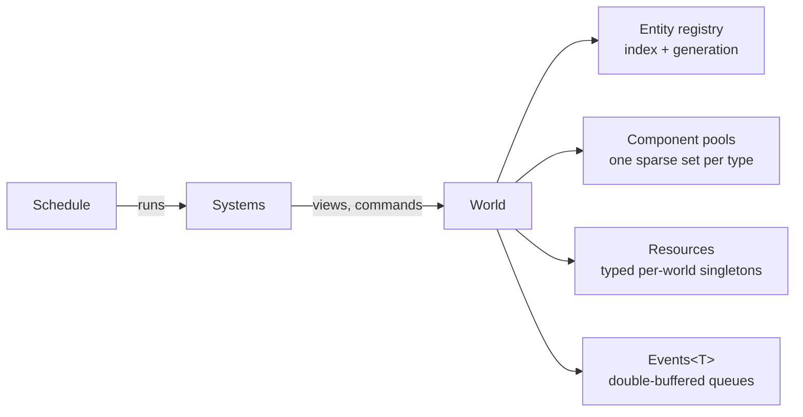
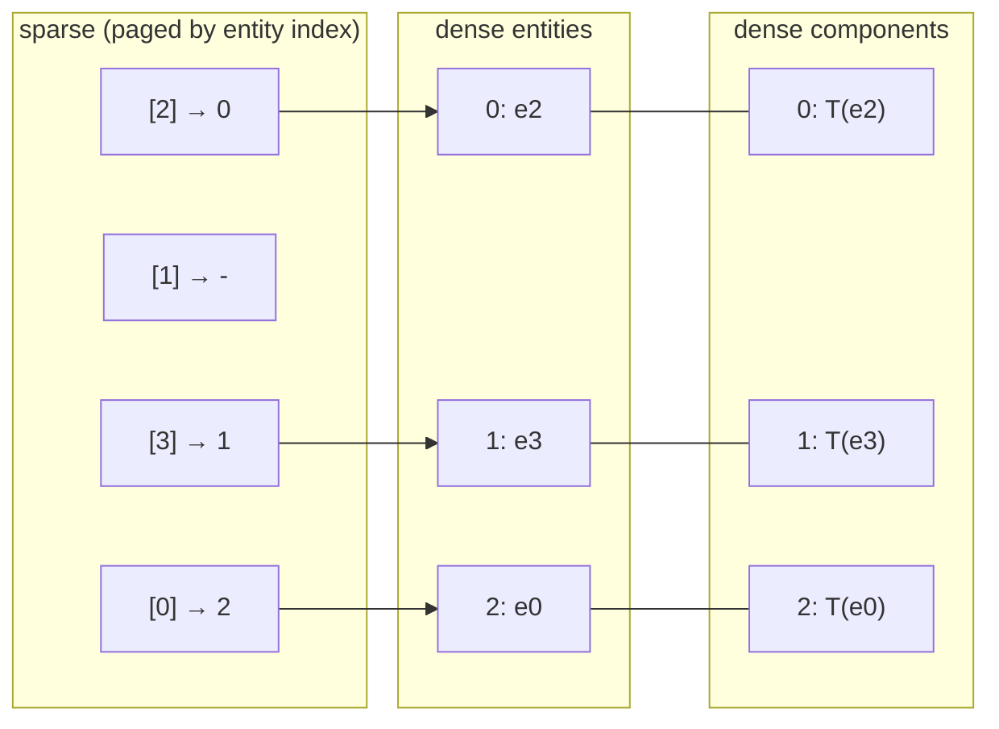

# Entity Component System

Teserra's ECS (`teserra_ecs`, layer 4) is written from scratch ([ADR-0007](../adr/0007-custom-ecs.md)) using sparse-set storage ([ADR-0019](../adr/0019-ecs-storage-sparse-sets.md)). It depends only on `teserra_core`; it knows nothing about rendering, assets or windows. The scene layer (`teserra_scene`) builds on it.

## Scope

| v1 (v0.1) | Future |
|---|---|
| `World`, generational `Entity`, sparse-set pools, multi-component views with exclusion | Owning groups / sorted pools (benchmark-driven) |
| Deferred structural changes (`Commands`) | Component add/remove hooks (observers) |
| Per-world resources and double-buffered events | Relations (parent/child as first-class ECS feature) |
| `Schedule` with phases, ordering constraints, declared data access, single-threaded execution | Parallel executor using declared access |
| Component metadata (name, size, alignment, lifecycle, optional fields) | Serialization, prefabs, editor inspection, scripting bindings |

## Concepts



- **World:** owns entities, component pools, resources and event queues. Several worlds can coexist (tests, editor previews). Entities never move between worlds.
- **Entity:** `ecs::Entity`, a generational handle ([ADR-0020](../adr/0020-generational-handles.md)): 32-bit index + 32-bit generation. Null entity = default-constructed.
- **Component:** any C++ type that is move-constructible and destructible. No base class, no virtuals. Empty types are **tags** and store no data.
- **View:** iteration over all entities that have a set of components (and optionally lack others).
- **System:** a callable taking `SystemContext&`, registered in a `Schedule` with a name, phase, ordering and declared data access.
- **Resource:** a typed per-world singleton (`Time`, `Input` snapshot, `Gravity`), the replacement for global variables.
- **Event:** typed message queues for decoupled communication (`CollisionStarted`, `PlayerDied`).

## Entities

- The registry stores one `u32 generation` per index and a FIFO free list of indices.
- `create()` pops a free index (or appends) and returns `{index, generation}`. Live generations start at 1.
- `destroy(e)` removes all of the entity's components, increments the generation and enqueues the index. Destroying a stale entity is a programmer error (assert); `isAlive(e)` checks without asserting.
- v1 destroys by asking each pool to remove the entity (O(number of pools)). A per-entity component bitmask is a planned optimization if benchmarks show it matters.

## Component storage

Each component type has a `ComponentPool<T>`, a sparse set:



- **Sparse** array: entity index → dense index, allocated in pages (4096 entries) on demand, so rare components do not allocate the full index range.
- **Dense** arrays: entities and components packed contiguously in the same order. Single-component iteration is a linear walk.
- **Add:** append to dense arrays, write sparse entry. **Remove:** swap the last element into the hole, pop, fix the moved entity's sparse entry (swap-and-pop). Both O(1).
- Membership checks also compare the stored entity's generation, so stale entities never match.
- Pointers/references to components are valid until the next structural change **of that pool**. Code must not hold component pointers across frames; hold the `Entity` instead.
- Iteration order is unspecified and changes after removals.

### Component types and metadata

```cpp
struct Velocity { Vec3 value; };
struct Enemy {};                       // tag

TESERRA_COMPONENT(Velocity, "Velocity")   // optional explicit registration with a stable name
```

- Each component type has a `TypeKey`: a 64-bit hash of a stable type name (explicit name if registered, otherwise a compiler-derived name). TypeKeys are stable across builds and across shared-library boundaries (no reliance on static counters or RTTI).
- The world maps `TypeKey` → pool. Views cache pool pointers once at creation, so iteration never hashes.
- `ComponentMeta` records name, size, alignment, and type-erased construct/move/destroy functions. Optional **field descriptors** (`name`, `offset`, `FieldType`) can be registered for a type. v1 does not consume them yet; they exist so that serialization, the editor inspector and scripting bindings can be added without changing component definitions ([ADR-0014](../adr/0014-scripting-deferred.md)).

## Views

```cpp
// All entities with Transform and Velocity, but not Frozen
for (auto [entity, transform, velocity] : world.view<Transform, const Velocity>(exclude<Frozen>)) {
    transform.position += velocity.value * dt;
}

world.each<Transform, const Velocity>([dt](Entity, Transform& t, const Velocity& v) {
    t.position += v.value * dt;
});
```

- A view iterates the **smallest** included pool and checks membership in the others and non-membership in excluded pools.
- `const` component types in the view express read-only access (used by access validation).
- **No structural changes during iteration** to pools touched by the view. Debug builds keep an iteration lock count per pool and assert on add/remove/destroy while locked. Use `Commands` instead.

## Structural changes: Commands

```cpp
void spawnBullets(SystemContext& ctx) {
    for (auto [e, gun, transform] : ctx.view<Gun, const Transform>()) {
        if (gun.cooldown <= 0.0f) {
            Entity bullet = ctx.commands().create();
            ctx.commands().add<Transform>(bullet, transform);
            ctx.commands().add<Velocity>(bullet, {gun.direction * gun.muzzleSpeed});
            gun.cooldown = gun.fireInterval;
        }
    }
}
```

- `Commands` records creates, destroys, adds and removes into a reused buffer. Entities created through commands get reserved IDs immediately (usable in the same buffer).
- Commands are applied at **sync points**: after each schedule phase, in recording order. This makes structural changes deterministic.

## Resources and events

- `world.insertResource<T>(value)`, `world.resource<T>()`, `world.tryResource<T>()`. Engine services exposed to gameplay (time, input state, asset registry access, debug draw) are resources or members of `SystemContext`, never globals.
- `Events<T>` is double-buffered: events sent in frame N can be read during frames N and N+1, then are dropped. Each reader keeps a cursor, so several systems can read the same events once each.

## Systems and scheduling

```cpp
schedule.add(Phase::Update, "player_movement", playerMovement)
    .reads<Input>().reads<Player>().writes<Transform>()
    .after("input_mapping");
```

- `ecs::Schedule` holds systems grouped by **phase**. The scene layer defines the standard phases: `Startup`, `PreUpdate`, `FixedUpdate`, `Update`, `PostUpdate`, `Extract` (render extraction), `Last`.
- Within a phase, systems run in registration order, adjusted by explicit `before()`/`after()` constraints (topological sort; cycles are a configuration error reported at schedule build time).
- **Declared access** (`reads<T>`, `writes<T>`, resources and events) is mandatory. In debug builds, views and resource accessors obtained through `SystemContext` assert if a system touches data it did not declare. v1 executes systems **sequentially** on the main thread; the declarations are the contract that a future parallel executor relies on.
- `FixedUpdate` runs zero or more times per frame from the fixed-step accumulator (platform `Clock` + engine loop).
- Systems are plain callables, so a future script-defined system registers the same way.

## Scenes own worlds

- `scene::Scene` owns one `ecs::World`, one `ecs::Schedule` configured with the standard phases, and scene-level resources.
- `scene::SceneManager` (owned by `App`) holds the active scene and switches scenes **at frame boundaries** (never in the middle of a schedule).
- Engine-provided systems (transform propagation, render extraction, tilemap chunk updates) are added to every scene by the engine; games add their own.

## Roadmap: from simple and correct to benchmarked and optimized

| Stage | Content | Exit criterion |
|---|---|---|
| 1. Correct (v0.1, iteration "Custom ECS core") | Registry, sparse-set pools, views, exclusion, tests incl. randomized comparison against a naive reference model | All invariants covered by tests; ASan clean |
| 2. Usable (v0.1, iteration "Scene, transforms and systems") | Commands, resources, events, schedule with declared access, scenes | Demo game written without touching ECS internals |
| 3. Measured (v0.1) | Catch2 benchmarks: create/destroy 100k, iterate 1 and 3 components over 100k, add/remove tags 10k/frame, view with 50% overlap | Baseline numbers recorded in the benchmark PR and in ecs docs |
| 4. Optimized (v0.2+) | Per-entity component mask, sorted pools, owning groups for hot combinations, view caching | Each change shows a benchmark improvement ≥10% on the target case without regressing others |
| 5. Parallel (v1.0+) | Parallel executor over declared access, job system | Same results as sequential execution in determinism tests |
| 6. Data-driven (v0.3+) | Serialization, prefabs, editor inspection, scripting bindings from metadata | Round-trip save/load tests |

Reference reading (not dependencies): Michele Caini's "ECS back and forth" series (EnTT), Sander Mertens' "Building an ECS" series (flecs), Bevy ECS documentation.
