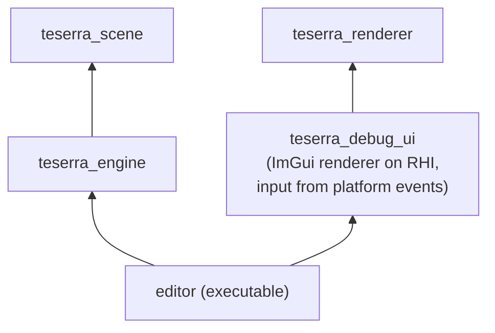

# Editor and scripting (future)

Neither an editor nor scripting is part of v0.1. This page records how v1 avoids blocking them, so that adding them later is an extension rather than a refactor. Decisions: [ADR-0013](../adr/0013-dear-imgui-debug-ui-and-editor.md), [ADR-0014](../adr/0014-scripting-deferred.md).

## Timeline

| Version | Content |
|---|---|
| v0.2 | ImGui debug tools: frame stats overlay, log console, entity list + component inspector (read-only), asset list, renderer stats (draws, batches, pipeline cache) |
| v0.3 - v1.0 | Editor executable: scene view, hierarchy, inspector with editing, asset browser, play-in-editor, save/load scenes |
| v3 - v4 | Scripting language integration |

## Editor architecture (planned)

- The editor is a **separate executable** linking the engine; the runtime never links editor code.
- ImGui is rendered through an engine-owned RHI backend, with input from engine `Event`s ([ADR-0013](../adr/0013-dear-imgui-debug-ui-and-editor.md)).
- **Play-in-editor** runs the game scene in a separate `World` copied from the edited one; stopping play discards the copy. This depends on serialization of components (metadata, below).
- The editor renders the scene into an offscreen `RenderTarget` displayed as an ImGui image; the same render target mechanism games use.

### Prerequisites the editor needs from v1

| Need | Provided in v1 by |
|---|---|
| Inspect components generically | `ComponentMeta` with optional field descriptors ([ECS](ecs.md#component-types-and-metadata)) |
| Multiple worlds side by side | `World` is not a singleton; scenes own worlds |
| Render into a panel | Offscreen render targets, composite pass optional |
| Stable asset references in saved scenes | `AssetId` (GUIDs added with the editor) |
| Undo/redo | Command pattern on editor operations (editor-side), plus deterministic `Commands` application |
| Picking | Render extraction keeps entity IDs per draw item (debug builds) |

## Scripting future-proofing

The v1 architecture keeps these properties, which every candidate scripting approach (Lua, C#, Wren, C++ hot reload) needs:

1. **Reflection-ready components.** Component metadata (name, size, alignment, lifecycle functions, field descriptors) is registered without RTTI. Bindings can be generated from it. Components are plain data with no hidden invariants managed by virtual methods.
2. **Systems are data.** Systems are callables registered with a name, phase and declared access. A script system is a callable that forwards to the VM.
3. **Handles cross boundaries.** `Entity`, `Asset<T>` IDs and RHI handles are plain integers with generation checks, safe to store in a script VM.
4. **No hidden globals.** Engine services are reachable through `SystemContext` and world resources, which a binding layer can expose explicitly.
5. **Dynamic libraries.** The platform layer's `DynamicLibrary` (backlog) is the primitive for C++ hot reload and plugins.
6. **Event queues.** Typed events are the natural bridge for script callbacks without re-entrancy into engine internals.

### What not to do before v3

- Do not add a "script component" placeholder or a scripting interface "for later". Unexercised abstractions rot.
- Do not design component APIs around a specific language's object model.

## Revisit triggers

- Feedback rounds show the lack of an editor (or scripting) is the main reason testers stop using Teserra.
- The public API has been stable for two minor versions (prerequisite for both).
