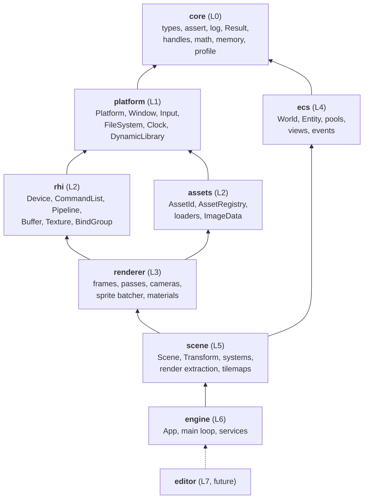
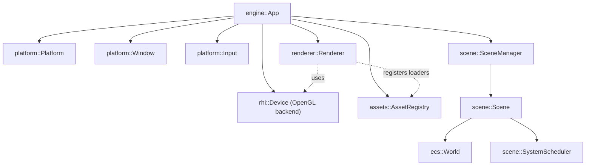
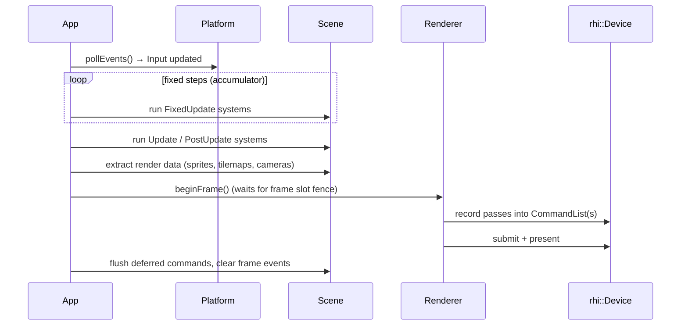

# Architecture overview

Teserra is a layered C++20 engine. v1 ships a 2D engine; every layer is designed so that 3D rendering, a Vulkan backend and a Linux port are **additions**, not rewrites.

This page is the map. Each layer has its own document:
[RHI](rhi.md) · [renderer](renderer.md) · [platform](platform-abstraction.md) · [ECS](ecs.md) · [assets](assets.md) · [memory and performance](memory-and-performance.md) · [editor and scripting (future)](editor-and-scripting-future.md).

## Design goals

1. **Understandable.** A contributor can read one module without reading the ones above it.
2. **Strict dependency direction.** Lower layers never know about upper layers. No exceptions, no "just this once" includes.
3. **Backend and platform neutrality above the line.** Nothing above `rhi`/`platform` sees OpenGL, GLFW or Win32 types.
4. **Explicit over implicit.** Services are passed as parameters or reachable from an explicit context object; no hidden singletons.
5. **Simple and correct first, fast second, measured always.**

Non-goals for v1: multithreaded rendering, 3D rendering, Vulkan, Linux/macOS support, scripting, an editor, audio. Each has a documented future path.

## Layers



Arrows point from a module to what it depends on. A module may depend on any module in a **strictly lower** layer; same-layer and upward dependencies are forbidden.

| Layer | Module (CMake target) | Responsibility | May depend on | Third-party (visibility) |
|---|---|---|---|---|
| 0 | `teserra_core` | Fundamental types, assertions, logging facade, `Result`, generational handles, math aliases, allocators, profiling macros | - | glm (PUBLIC), tl-expected (PUBLIC), spdlog (PRIVATE), Tracy (PRIVATE, optional) |
| 1 | `teserra_platform` | OS and windowing services behind interfaces | core | GLFW (PRIVATE) |
| 2 | `teserra_rhi` | Backend-agnostic GPU interface, command recording, validation | platform | - |
| 2 | `teserra_rhi_opengl` | OpenGL 4.5 backend (separate target, linked by `engine`) | rhi | glad (vendored, PRIVATE) |
| 2 | `teserra_rhi_null` | Recording/validating backend for headless tests | rhi | - |
| 2 | `teserra_assets` | Asset IDs, handles, registry, loader interfaces, CPU-side decoding | platform | stb_image (PRIVATE) |
| 3 | `teserra_renderer` | Frame structure, render passes, cameras, materials, sprite batching, debug draw | rhi, assets | - |
| 4 | `teserra_ecs` | Entities, component storage, views, events, deferred commands | core | - |
| 5 | `teserra_scene` | Scenes owning worlds, transforms, system scheduling, ECS-to-renderer extraction, tilemaps | ecs, renderer, assets | - |
| 6 | `teserra_engine` | `App`, main loop, wiring of services, backend selection, umbrella header `<teserra/teserra.hpp>` | scene, rhi backends | - |
| 7 | `teserra_editor` (future) | Editor executable | engine | Dear ImGui |

Notes:

- `ecs` depends only on `core`. It sits above `renderer` so that **the renderer can never depend on the ECS**. The renderer consumes plain render data; `scene` extracts that data from the ECS.
- `assets` is a sibling of `rhi`: it knows files and CPU-side data, not GPU objects. GPU-resident asset types (textures, shaders) are created by loaders that the **renderer** registers with the asset registry.
- Backends (`teserra_rhi_opengl`, `teserra_rhi_null`, later `teserra_rhi_vulkan`) are linked only by `teserra_engine` and tests. The renderer links only the abstract `teserra_rhi`.

## How the layering is enforced

Rules that rely on discipline erode. Teserra enforces layering mechanically at three points:

1. **CMake configure time.** Every module is declared with

   ```cmake
   teserra_add_module(renderer LAYER 3 DEPENDS rhi assets)
   ```

   The helper (in `cmake/TeserraModule.cmake`) creates `teserra_renderer` + alias `Teserra::Renderer`, sets include directories, links `DEPENDS` as `PUBLIC` engine dependencies, and **fails configuration** if any dependency has a layer number ≥ the module's own. Third-party libraries are linked separately with `teserra_link_third_party(<module> PRIVATE spdlog::spdlog)`, which makes visibility a reviewed, explicit choice.
2. **Include check (CI).** `tools/scripts/check_layers.py` scans `#include <teserra/<module>/...>` in each module and fails if a module includes headers of a module it does not depend on. This catches include-path leakage through transitive `PUBLIC` dependencies.
3. **Leak checks (CI).** `tools/scripts/check_gl_leaks.py` fails if GL identifiers (`GL_*`, `gl[A-Z][a-z]*`, `GLuint`, `<glad/`) appear outside `engine/rhi/backends/opengl/` (Vulkan ones outside `engine/rhi/backends/vulkan/`), if GLFW names or headers appear outside `engine/platform/src/glfw/`, and if Win32 headers appear outside Windows-only files of `engine/platform/`. `glm::` outside `engine/core/` is flagged by the same script ([ADR-0008](../adr/0008-glm-math-behind-aliases.md)). The exact rules are in [build-and-ci](../guides/build-and-ci.md#layer-and-leak-checks).

## Runtime structure



- `App` owns all services by value or `std::unique_ptr` and passes them **by reference** to whoever needs them. Construction order is the dependency order; destruction is reverse (RAII).
- Gameplay systems reach services through a `SystemContext` (world, time, input, assets, renderer-facing debug draw), never through globals.
- There is **no engine singleton**. Tests can create several `World`s, a null `Device`, or a headless `Platform` side by side.

## Frame flow (v1)



- **Single-threaded in v1.** Everything runs on the main thread. Data structures are designed so that render extraction and command recording can move to worker threads later (command lists do not touch backend state while recording; systems declare data access).
- Fixed-timestep simulation (`FixedUpdate`, default 60 Hz) with variable-rate rendering. Interpolation of transforms is a future option.

## Cross-cutting policies

| Topic | Policy | Source of truth |
|---|---|---|
| Errors | Assertions for bugs, `Result<T>` for recoverable errors, `TESERRA_FATAL` for unrecoverable; engine code never throws | [ADR-0016](../adr/0016-error-handling-policy.md) |
| Logging | `TESERRA_LOG_*` facade, categories, compile-time floor | [ADR-0011](../adr/0011-logging-spdlog-facade.md) |
| Profiling | `TESERRA_PROFILE_*` macros, Tracy when enabled | [ADR-0023](../adr/0023-profiling-tracy.md) |
| Handles | Generational handles for all runtime resources | [ADR-0020](../adr/0020-generational-handles.md) |
| Conventions | Right-handed Y-up, depth `[0, 1]`, top-left texture origin | [ADR-0024](../adr/0024-coordinate-conventions.md) |
| Memory | No per-frame heap allocations in hot paths after warm-up | [memory and performance](memory-and-performance.md) |
| Patterns | Only patterns from the catalog; deviations need an ADR/RFC | [patterns and conventions](../guides/patterns-and-conventions.md) |

## v1 vs future

| Area | v1 (v0.1 release) | Future |
|---|---|---|
| Rendering | 2D: sprites, tilemaps, cameras (ortho), debug draw, offscreen targets | 3D renderer, render graph, lighting, post-processing (v2) |
| Backends | OpenGL 4.5, null | Vulkan (v2), possibly Metal/D3D12 |
| Platforms | Windows (supported), Linux (core modules built in CI) | Linux supported (v0.2), others later |
| Threading | Single-threaded | Job system, parallel systems, render thread |
| Tools | Examples, Tracy | ImGui debug tools (v0.2), editor (v0.3+), asset cooker |
| Gameplay | C++ | Scripting (v3-v4) |
