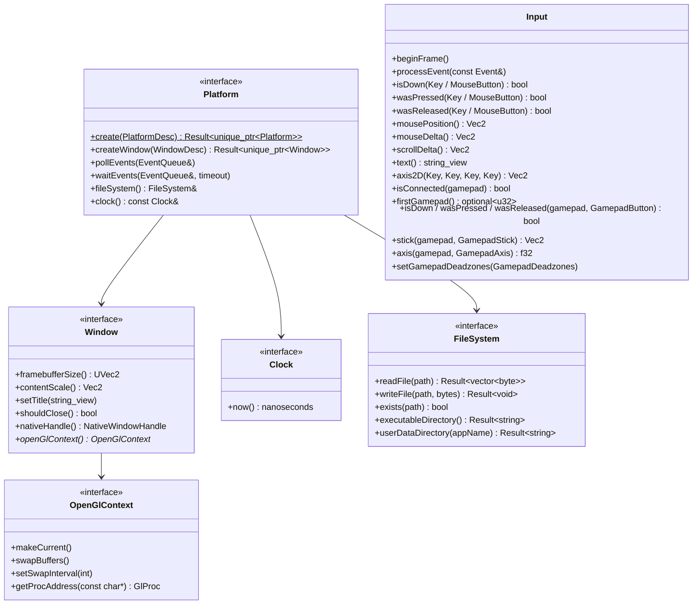

# Platform abstraction

The platform layer (`teserra_platform`, layer 1) hides the operating system and the windowing library. Everything above it is OS-neutral. Decisions: [ADR-0015](../adr/0015-windows-first-platform-abstraction.md), [ADR-0006](../adr/0006-glfw-behind-engine-interfaces.md).

## Scope

| v1 (v0.1) | Future |
|---|---|
| Windows 10/11 x64 supported | Linux (X11 + Wayland via GLFW) in v0.2; others later |
| Window (create, resize, close, content scale, title, cursor modes), OpenGL context provider | Multiple windows (editor), fullscreen modes, custom cursors |
| Keyboard and mouse input with per-frame edges, text input events | Gamepads (backlog), touch, IME composition |
| Monotonic clock and frame timer | High-resolution sleep / frame pacing helpers |
| File system: read/write whole files, executable and user-data directories | File watching (asset hot reload), async IO, packaged archives |
| Thread naming helper | Job system (separate module), thread affinity |
| | Dynamic library loading (backlog, needed for C++ hot reload and plugins) |

## Interfaces

All public headers live in `engine/platform/include/teserra/platform/`.



- **`Platform`** is an *abstract factory* for the windowing system and OS services. It owns the windowing library's global state (GLFW init/terminate) via RAII. It is created once by `engine::App` (or by a test) and passed by reference; it is **not** a singleton.
- **`Window`** exposes sizes in two units: window size (screen coordinates) and framebuffer size (pixels). The renderer only uses framebuffer size. `nativeHandle()` returns a tagged `NativeWindowHandle` (`{ kind; void* window; void* display; }`) so future backends (Vulkan surface creation) do not need GLFW.
- **`OpenGlContext`** is the only GL-aware interface outside the RHI backend. It contains no GL types (function pointers only) and is `nullptr` when the window was created without an OpenGL context (`WindowDesc::graphicsApi = GraphicsApi::None` for Vulkan/headless later).
- **Events.** `pollEvents()` translates OS/GLFW callbacks into engine `Event`s (`WindowResized`, `WindowCloseRequested`, `FocusChanged`, `KeyChanged`, `TextEntered`, `MouseButtonChanged`, `MouseMoved`, `MouseScrolled`, and for [gamepads](#gamepads) `GamepadConnectionChanged`, `GamepadButtonChanged`, `GamepadAxisMoved`) and appends them to an `EventQueue` (a reused vector of `std::variant`s). Nothing is delivered through user callbacks from inside GLFW, except the live-resize handler below.
- **Live resize** (#184). On Windows, dragging a window border runs the window system's own loop on the main thread until the mouse button is released, so `pollEvents()` does not return in between, and a window that nothing redraws shows its last frame cut off or stretched. `Platform::setLiveResizeHandler(f)` sets a function that the GLFW backend calls from inside `pollEvents()` / `waitEvents()` whenever the framebuffer gets a new, non-zero size there. The events of the poll so far, ending with that `WindowResized`, are already in the poll's queue; the handler finishes a frame with them and may clear the queue, which the poll goes on appending to. It is not called while it runs, nor outside a poll (`Window::setSize()`). The App sets it for the length of `run()`: each call finishes the frame whose poll is underway (events, updates, render, present) and begins the next, so a drag runs one frame per new size. Frames stop while the mouse holds still or moves the window without resizing it, as the window system sends nothing then; the next frame drops the fixed steps it missed, like after any stall.
- **Waiting.** `waitEvents(queue, timeout)` sleeps until a window system message arrives or `timeout` passes, then works like `pollEvents()`; the GLFW backend uses `glfwWaitEventsTimeout`. The App calls it while the window is minimized, so a loop with nothing to draw does not spin. The default implementation does not wait.
- **`Input`** is backend-independent: it consumes `Event`s and records key and button edges per event, so `wasPressed()` means "went down since the last `beginFrame()`", and a tap shorter than a frame still reports both `wasPressed()` and `wasReleased()`. Key repeat creates no edges; `FocusChanged{false}` releases everything held. It also tracks the mouse position and per-frame movement, scrolling and typed text (UTF-8), offers `axis2D()` for WASD-style movement, and keeps the state of up to 16 [gamepads](#gamepads). It is a copyable value, and tests drive it with synthetic events.
- **Keys** are an engine enum `platform::Key` based on *physical* key positions (US layout names, like `Key::W`), plus `TextEntered` events for text; mouse buttons are `platform::MouseButton`. The GLFW backend translates codes in one table, `src/glfw/glfw_key_table.cpp`, whose `static_assert` fails the build if a `Key` has no mapping.
- <a id="gamepads"></a>**Gamepads** (#133) have one standard layout (`<teserra/platform/gamepad.hpp>`): `GamepadButton` (face buttons named by position, `South` is A on Xbox and Cross on PlayStation; bumpers, Back, Start, Guide, stick clicks, d-pad) and `GamepadAxis` (two sticks from -1 to 1 with +Y up as in [ADR-0024](../adr/0024-coordinate-conventions.md), two triggers from 0 to 1). The GLFW backend maps each controller onto it with GLFW's gamepad mappings (SDL's controller database), on Windows and Linux alike; joysticks without a mapping are ignored.
  - **Polled, then events.** GLFW reports gamepads by polling, not by callbacks. At the end of every `pollEvents()` the backend reads each of the 16 joystick slots and a portable `GamepadTracker` (`src/common/`) compares it with the previous poll: it emits `GamepadConnectionChanged`, then a `GamepadButtonChanged` for each button that changed and a `GamepadAxisMoved` for each axis that changed (raw values). A new gamepad reports what it already holds; a removed one reports only its disconnection. A press and release between two polls is not seen. Connections are logged with the controller's name. GLFW sets up joystick support on first use, which takes about 0.1 s on Windows (DirectInput); `Platform::create()` does it, so the first frame does not stall. Afterwards a poll of all slots takes microseconds.
  - **Input** keeps per-gamepad state: `isDown()`, `wasPressed()` and `wasReleased()` with edges as for keys, `stick()` and `axis()` with deadzones, `rawAxis()` without. Disconnecting releases the gamepad's buttons and rests its axes; losing window focus does not touch gamepads, since their state is polled, not lost. A gamepad keeps its index (0 to `kMaxGamepads - 1`) while connected; `firstGamepad()` is the lowest connected one, for single-player games.
  - **Deadzones** (`GamepadDeadzones`, default 0.2 for sticks and 0.1 for triggers): a stick's deadzone is radial, on the length of its direction, so a diagonal is not cut to an axis; past the deadzone the rest of the range is rescaled to 0..1, so small movements start at 0 and full deflection still reaches 1, and corner readings longer than 1 are clamped.
  - **Not yet:** rumble, remapping, and per-gamepad deadzones.
- **`Clock`** returns monotonic time as `std::chrono::nanoseconds`. `SteadyClock` wraps `std::chrono::steady_clock` (high resolution and monotonic on all supported platforms) and is what `Platform::clock()` returns. It is an interface for testability (a `ManualClock`, advanced by hand, drives loop and fixed-step tests, and a test platform can return one), not for portability.
- **`FrameTimer`** and **`FixedStepAccumulator`** are plain values fed explicit times. `FrameTimer::tick(clock.now())` gives the frame delta, the elapsed time and an FPS value averaged over 500 ms windows. `FixedStepAccumulator::advance(delta)` returns how many fixed steps (default 1/60 s) to run this frame, carries time below one step over to the next frame, and drops whole steps beyond `maxStepsPerFrame` (default 5) after a stall, so a slow simulation cannot fall into a spiral of death.
- **`FileSystem`** (`<teserra/platform/file_system.hpp>`) reads and writes whole files. `NativeFileSystem` is the operating system's; `Platform::fileSystem()` returns one, may be used from any thread, and tools and tests can create their own. It is an interface so that tests can use another file system (an in-memory one for asset loaders).
  - **Paths** are UTF-8 `std::string_view`s at the API ([ADR-0015](../adr/0015-windows-first-platform-abstraction.md)). Inside, `std::filesystem::path` is built from a `std::u8string_view`, never from a `std::string`, which Windows would read in the ANSI code page. Invalid UTF-8, an empty path or a null character is `InvalidArgument`, checked before `std::filesystem` sees the path, so it never throws.
  - **Directories:** `executableDirectory()` and `userDataDirectory(appName)` (`%APPDATA%\<appName>` on Windows, created if missing) return absolute paths with `/` separators and no trailing separator, so `dir + "/save.dat"` works on every OS. `appName` must be one directory name that is valid on every supported OS.
  - **`writeFile`** writes `<path>.tmp` and renames it over the file, so a crash during the write keeps the previous content. It does not create parent directories.
  - **Errors** name the path: `NotFound`, `AccessDenied`, `InvalidArgument` (also for a directory), `IoFailure`.
  - **OS-specific** are only `executableDirectory()` and `userDataDirectory()`, in `src/windows/file_system_windows.cpp`; reading, writing and `exists()` are portable (`src/common/native_file_system.cpp`).
- **Threading:** use `std::thread`/`std::jthread`, `std::mutex`, `std::atomic`, `std::condition_variable` directly. The platform layer adds only `setCurrentThreadName()`. All window and event functions must be called on the main thread (asserted in debug builds).

## Selection mechanism

There is exactly one window backend (GLFW) in v1, and one OS implementation per platform. Selection is **compile-time, in CMake**, never by `#ifdef` in shared code:

```cmake
# engine/platform/CMakeLists.txt (illustrative)
teserra_add_module(platform LAYER 1 DEPENDS core)
target_sources(teserra_platform PRIVATE src/common/input.cpp src/common/event_queue.cpp)

set(TESERRA_WINDOW_BACKEND "GLFW" CACHE STRING "Window backend")
if(TESERRA_WINDOW_BACKEND STREQUAL "GLFW")
    target_sources(teserra_platform PRIVATE src/glfw/glfw_platform.cpp src/glfw/glfw_window.cpp
                                            src/glfw/glfw_key_table.cpp)
    teserra_link_third_party(platform PRIVATE glfw)
endif()

if(WIN32)
    target_sources(teserra_platform PRIVATE src/windows/file_system_windows.cpp
                                            src/windows/thread_windows.cpp)
elseif(UNIX)
    target_sources(teserra_platform PRIVATE src/posix/file_system_posix.cpp
                                            src/posix/thread_posix.cpp)
endif()
```

`Platform::create()` is implemented by the selected window backend. If a second backend appears (SDL3), it is another CMake choice behind the same interface.

### Directory rules

```text
engine/platform/
├── include/teserra/platform/   # Interfaces and portable types only
├── src/common/                 # Portable implementation (Input, EventQueue, Clock)
├── src/glfw/                   # Only place GLFW headers are included
├── src/windows/                # Only place <windows.h> is included
└── src/posix/                  # Linux/BSD implementation (future)
```

- `<windows.h>` is included with `WIN32_LEAN_AND_MEAN` and `NOMINMAX`, only in `src/windows/*.cpp`, never in a header.
- The one place a GLFW header and an OS header meet is `src/glfw/glfw_native_<os>.cpp`, which reads the native window handles through `<GLFW/glfw3native.h>` (it needs `<windows.h>` on Windows). CMake compiles it for the GLFW backend on that OS only.
- Shared code never contains `#ifdef _WIN32`. Use the platform macros from `<teserra/core/config.hpp>` only inside `engine/platform/` (and, rarely, core).

## v1 Linux readiness

A non-blocking Linux CI job builds and tests `core`, `ecs` and the RHI null backend from iteration 9. It catches compiler differences (GCC/Clang), missing includes, and accidental Windows API use in portable modules. The platform module itself is not built on Linux until the port starts.

## New platform port checklist

Use this list when adding Linux (or any platform). If a step requires touching code outside `engine/platform/` and CMake, the abstraction has leaked: fix the abstraction first.

1. **CMake:** add the platform branch in `engine/platform/CMakeLists.txt`; add configure/build/test presets (`linux-gcc-debug`, `linux-clang-debug`).
2. **OS services:** implement `src/<os>/file_system_<os>.cpp` (`executableDirectory`, `userDataDirectory` per platform conventions, e.g. XDG) and `thread_<os>.cpp` (`setCurrentThreadName`).
3. **Window backend:** build the GLFW backend; verify OpenGL 4.5 core context creation; verify `NativeWindowHandle` kinds (X11 and Wayland).
4. **Input:** verify key table and physical key mapping; text input events; content scale on HiDPI displays; gamepads (fill a `GamepadSnapshot` per slot at every poll for `GamepadTracker`).
5. **Dynamic libraries** (once used): implement `dlopen`/`dlsym` wrapper.
6. **Config:** confirm `TESERRA_PLATFORM_*` macros in `config.hpp`.
7. **Dependencies:** confirm all vcpkg ports build on the platform (glfw3 system dependencies documented).
8. **CI:** make the platform job blocking; add GPU tests if a software rasterizer is available.
9. **Docs:** update build instructions, supported platforms table in README, this checklist with lessons learned.
10. **Release:** add platform artifacts to the release workflow.

### Lessons of the Linux port (#127)

The port is done for v0.2 ([ADR-0026](../adr/0026-linux-support-targets.md)): steps 1–4 and 6–9 above (#280–#284); step 5 waits for the first dynamic library (#134), step 10 for the v0.2 release (#287).


Before the port, the non-blocking `linux-portable` CI job (#68) built only `TESERRA_PORTABLE_ONLY` with GCC and Clang on `ubuntu-latest`, warnings as errors: `core`, `ecs`, `rhi` + null backend, and the portable part of `platform` (no OS services, no window backend). Since #283, three blocking `linux` jobs build and test everything (build-and-ci.md), and `linux-portable` keeps the build without a window system. What the portable job found:

- **`std::mt19937::result_type` is 64 bits on Linux** (`uint_fast32_t`), 32 on Windows. Storing `random() % n` in a `u32` compiles on MSVC and fails `-Wconversion` on GCC; cast explicitly.
- **GCC's `-Wshadow` flags a constructor parameter named like the member it initializes** (`Scene(Device& device) : device(device)`), which MSVC and Clang accept. Name the parameter differently.
- **GCC does not evaluate `consteval` calls in a discarded `if constexpr` branch,** where MSVC and Clang do. Log calls removed by `TESERRA_LOG_LEVEL_MIN` sat in such a branch, so on GCC their `std::format_string` check never ran and a wrong format string compiled (the compile-fail test `core.log.removed_call_format_string_is_checked` caught it). Nor does a lambda help: since P2564 (GCC 14+), a lambda whose body fails a `consteval` check becomes `consteval` itself instead of failing, an error only if it is called. The check now runs behind a plain `if (false)` in the branch that is taken, compiled in the caller's own function but never executed.
- **Clang found nothing** that MSVC and clang-tidy had not. The runner had GCC 15.2 and Clang 21.1 (November 2026); the job uses whatever `ubuntu-latest` ships.
- **Already portable:** `config.hpp`'s `TESERRA_PLATFORM_LINUX`, `assert.cpp`'s `SIGTRAP` debug break and `/proc/self/status` debugger check, the vcpkg toolchain file, and the GCC/Clang warning flags.
- **OS services on Linux** (step 2, #280): `src/posix/file_system_posix.cpp`. `executableDirectory()` reads the `/proc/self/exe` link, and `userDataDirectory()` follows the XDG Base Directory spec: `$XDG_DATA_HOME`, or `$HOME/.local/share` when it is unset, empty or relative (the spec says to ignore a relative value). Neither needs an OS header: `std::filesystem` and `std::getenv` do it. The portable build now includes the OS services wherever the OS has them, so the Linux job runs the file-system tests (`posix/file_system_posix_test.cpp` covers the XDG rules); only the window backend is left out. The one test that needs a `Platform` moved to `platform_test.cpp`.
- **GLFW on Linux** (steps 3, 4 and 7, #281): `src/glfw/glfw_native_linux.cpp` returns `Kind::X11` or `Kind::Wayland` handles, whichever GLFW picked at `glfwInit()` (it prefers Wayland when `WAYLAND_DISPLAY` is set). vcpkg's `glfw3` builds both backends (its `wayland` feature, enabled on Linux in `vcpkg.json` and the game template). On Ubuntu it needs `libxinerama-dev libxcursor-dev xorg-dev libglu1-mesa-dev pkg-config` for X11, and `libwayland-dev libxkbcommon-dev wayland-protocols extra-cmake-modules` for Wayland. Checked on Ubuntu 26.04 with GCC 15 and Clang 21: every platform test passes on X11 (Xvfb) and on Wayland (Weston), including an OpenGL 4.5 core context on Mesa llvmpipe (GLX on X11, EGL on Wayland). What it taught:
  - **`glXGetProcAddress` returns an address for any name,** so "an unknown function gives nullptr" holds only on Windows and EGL. `OpenGlContext::getProcAddress()` no longer promises it; availability comes from the GL version and extensions, as glad decides.
  - **A resize arrives later on X11 and Wayland.** Windows reports it during `setSize()`; X11 and Wayland report it when the server answers, so code (and tests) must not expect the `WindowResized` in the very next poll.
  - **`<X11/Xlib.h>` defines `None`, `Bool` and `Status`,** so the file that includes it names no engine identifier spelled like them (an empty handle is value-initialized instead of `Kind::None`).
  - **GLFW 3.4 crashes in `glfwInit()` on a compositor without a seat** (it reads the `wl_seat` without checking it). A headless Weston has none; a desktop session always has one, so tests use Weston's X11 backend inside Xvfb, which has a seat.
  - **libdecor loads its GTK plugin into the process** for window decorations on Wayland (GNOME); it works, and without a plugin GLFW falls back to no decorations. Without `XDG_RUNTIME_DIR`, libwayland prints an error while GLFW probes for Wayland, then GLFW uses X11.
- **The whole build on Linux** (step 7, #282): every module, the OpenGL backend, `teserra_shaderc`, the examples and the tests build with GCC 15 and Clang 21 with warnings as errors (`ci-linux-gcc`, `ci-linux-clang`), and all 681 tests pass on Mesa llvmpipe under Xvfb, GPU tests, snapshots and example smoke runs included. The code needed no platform `#ifdef`; what the compilers found was:
  - **libstdc++'s `std::stable_sort` allocates a buffer for any size,** where MSVC's does not for small ranges. The sprite pass sorted tilemap chunks with it, so every Linux frame allocated once (the steady-state allocation test caught it); an unstable sort keyed on (layer, index) keeps the same order without allocating. Iteration 8 had found the same about pass ordering.
  - **GCC's `-Wsign-conversion` and `-Wshadow` flag more than MSVC's `/W4`:** an `int` loop index into a `std::array`, `{GL_ENUM, ...}` lists that deduce `int` where `GLenum` is meant, and lambda parameters named like a local (`app`). Test code with designated initializers needs default member initializers on the structs it leaves out (`-Wmissing-field-initializers`), so the Tiled structs got them.
- **Compiler minimums come from the API's style** (#283): GCC 13 and 14.2, Ubuntu 24.04's GCCs, cannot brace-initialize a struct with a C-array member that has a default member initializer (`GraphicsPipelineDesc::colorBlend`, `RenderPassDesc::colorAttachments`), so even `createGraphicsPipeline({})` fails; GCC 14.3 fixed it. Only CI on the older LTS found it, since the dev container had GCC 15. Changing the headers would have changed how games write those structs, so the minimum is GCC 14.3 or Clang 18, and 24.04 uses its Clang.

## Anti-patterns specific to this layer

- Exposing `GLFWwindow*`, `HWND` or GLFW key codes in a public header (use `NativeWindowHandle` and engine enums).
- Calling the windowing library from the renderer or the RHI (the RHI receives `platform::Window&` / `OpenGlContext&` only).
- Wrapping portable standard facilities "for consistency" (`teserra::Mutex` around `std::mutex`) without a concrete reason.
