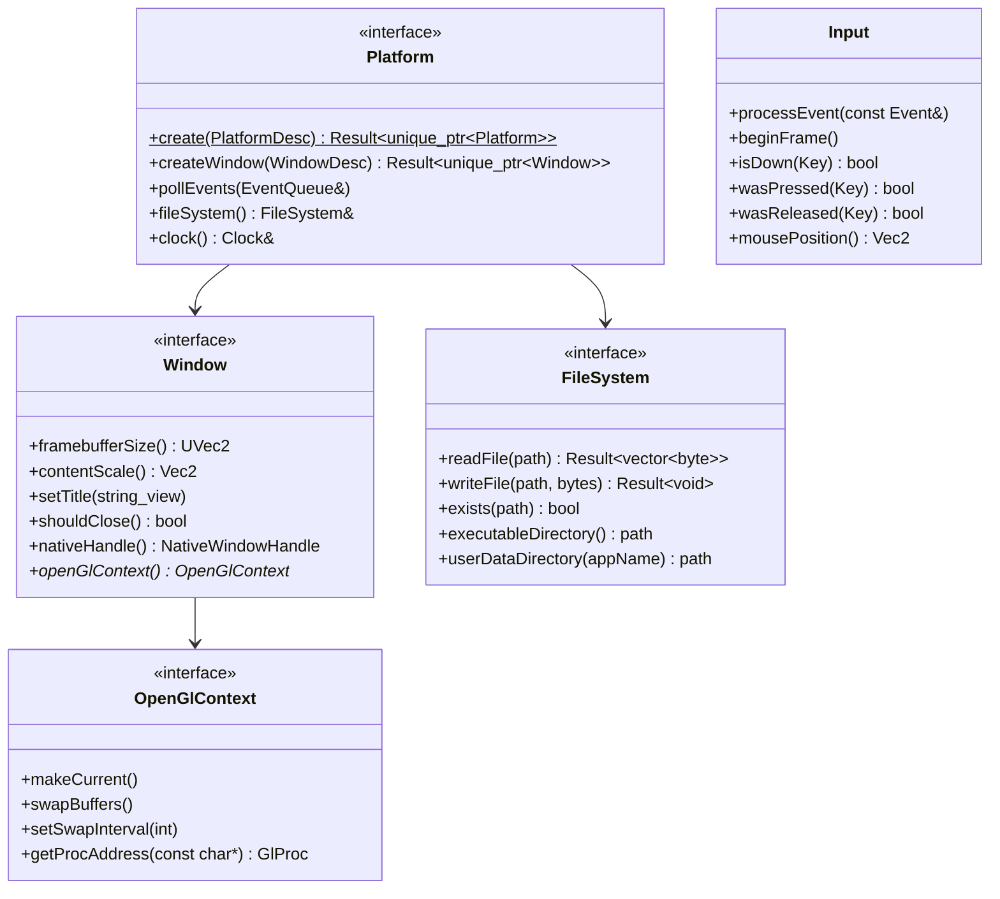

# Platform abstraction

The platform layer (`teserra_platform`, layer 1) hides the operating system and the windowing library. Everything above it is OS-neutral. Decisions: [ADR-0015](../adr/0015-windows-first-platform-abstraction.md), [ADR-0006](../adr/0006-glfw-behind-engine-interfaces.md).

## Scope

| v1 (v0.1) | Future |
|---|---|
| Windows 10/11 x64 supported | Linux (X11 + Wayland via GLFW) in v0.2; others later |
| Window (create, resize, close, content scale, title, cursor modes), OpenGL context provider | Multiple windows (editor), fullscreen modes, custom cursors |
| Keyboard and mouse input with per-frame edges, text input events | Gamepads (backlog), touch, IME composition |
| Monotonic clock and frame timer | High-resolution sleep / frame pacing helpers |
| File system: read/write whole files, executable and user-data directories | File watching (asset hot reload), async IO, packaged archives |
| Thread naming helper | Job system (separate module), thread affinity |
| | Dynamic library loading (backlog, needed for C++ hot reload and plugins) |

## Interfaces

All public headers live in `engine/platform/include/teserra/platform/`.



- **`Platform`** is an *abstract factory* for the windowing system and OS services. It owns the windowing library's global state (GLFW init/terminate) via RAII. It is created once by `engine::App` (or by a test) and passed by reference; it is **not** a singleton.
- **`Window`** exposes sizes in two units: window size (screen coordinates) and framebuffer size (pixels). The renderer only uses framebuffer size. `nativeHandle()` returns a tagged `NativeWindowHandle` (`{ kind; void* window; void* display; }`) so future backends (Vulkan surface creation) do not need GLFW.
- **`OpenGlContext`** is the only GL-aware interface outside the RHI backend. It contains no GL types (function pointers only) and is `nullptr` when the window was created without an OpenGL context (`WindowDesc::graphicsApi = GraphicsApi::None` for Vulkan/headless later).
- **Events.** `pollEvents()` translates OS/GLFW callbacks into engine `Event`s (`WindowResized`, `WindowCloseRequested`, `FocusChanged`, `KeyChanged`, `TextEntered`, `MouseButtonChanged`, `MouseMoved`, `MouseScrolled`) and appends them to an `EventQueue` (a reused vector of `std::variant`s). Nothing is delivered through user callbacks from inside GLFW.
- **`Input`** is backend-independent: it consumes `Event`s and keeps current/previous key and button state, so `wasPressed()` means "went down since last `beginFrame()`". Tests drive it with synthetic events.
- **Keys** are an engine enum `teserra::Key` based on *physical* key positions (US layout names, like `Key::W`), plus `TextEntered` events for text. The GLFW backend translates codes in one table.
- **`Clock`** wraps `std::chrono::steady_clock` (high resolution and monotonic on all supported platforms). It is an interface for testability (a `ManualClock` drives fixed-step tests), not for portability.
- **`FileSystem`** uses UTF-8 paths at the API (`std::filesystem::path` constructed from `std::u8string_view` where needed). Platform-specific parts are only `executableDirectory()` and `userDataDirectory()`.
- **Threading:** use `std::thread`/`std::jthread`, `std::mutex`, `std::atomic`, `std::condition_variable` directly. The platform layer adds only `setCurrentThreadName()`. All window and event functions must be called on the main thread (asserted in debug builds).

## Selection mechanism

There is exactly one window backend (GLFW) in v1, and one OS implementation per platform. Selection is **compile-time, in CMake**, never by `#ifdef` in shared code:

```cmake
# engine/platform/CMakeLists.txt (illustrative)
teserra_add_module(platform LAYER 1 DEPENDS core)
target_sources(teserra_platform PRIVATE src/common/input.cpp src/common/event_queue.cpp)

set(TESERRA_WINDOW_BACKEND "GLFW" CACHE STRING "Window backend")
if(TESERRA_WINDOW_BACKEND STREQUAL "GLFW")
    target_sources(teserra_platform PRIVATE src/glfw/glfw_platform.cpp src/glfw/glfw_window.cpp
                                            src/glfw/glfw_key_table.cpp)
    teserra_link_third_party(platform PRIVATE glfw)
endif()

if(WIN32)
    target_sources(teserra_platform PRIVATE src/windows/file_system_windows.cpp
                                            src/windows/thread_windows.cpp)
elseif(UNIX)
    target_sources(teserra_platform PRIVATE src/posix/file_system_posix.cpp
                                            src/posix/thread_posix.cpp)
endif()
```

`Platform::create()` is implemented by the selected window backend. If a second backend appears (SDL3), it is another CMake choice behind the same interface.

### Directory rules

```text
engine/platform/
├── include/teserra/platform/   # Interfaces and portable types only
├── src/common/                 # Portable implementation (Input, EventQueue, Clock)
├── src/glfw/                   # Only place GLFW headers are included
├── src/windows/                # Only place <windows.h> is included
└── src/posix/                  # Linux/BSD implementation (future)
```

- `<windows.h>` is included with `WIN32_LEAN_AND_MEAN` and `NOMINMAX`, only in `src/windows/*.cpp`, never in a header.
- The one place a GLFW header and an OS header meet is `src/glfw/glfw_native_<os>.cpp`, which reads the native window handles through `<GLFW/glfw3native.h>` (it needs `<windows.h>` on Windows). CMake compiles it for the GLFW backend on that OS only.
- Shared code never contains `#ifdef _WIN32`. Use the platform macros from `<teserra/core/config.hpp>` only inside `engine/platform/` (and, rarely, core).

## v1 Linux readiness

A non-blocking Linux CI job builds and tests `core`, `ecs` and the RHI null backend from iteration 9. It catches compiler differences (GCC/Clang), missing includes, and accidental Windows API use in portable modules. The platform module itself is not built on Linux until the port starts.

## New platform port checklist

Use this list when adding Linux (or any platform). If a step requires touching code outside `engine/platform/` and CMake, the abstraction has leaked: fix the abstraction first.

1. **CMake:** add the platform branch in `engine/platform/CMakeLists.txt`; add configure/build/test presets (`linux-gcc-debug`, `linux-clang-debug`).
2. **OS services:** implement `src/<os>/file_system_<os>.cpp` (`executableDirectory`, `userDataDirectory` per platform conventions, e.g. XDG) and `thread_<os>.cpp` (`setCurrentThreadName`).
3. **Window backend:** build the GLFW backend; verify OpenGL 4.5 core context creation; verify `NativeWindowHandle` kinds (X11 and Wayland).
4. **Input:** verify key table and physical key mapping; text input events; content scale on HiDPI displays.
5. **Dynamic libraries** (once used): implement `dlopen`/`dlsym` wrapper.
6. **Config:** confirm `TESERRA_PLATFORM_*` macros in `config.hpp`.
7. **Dependencies:** confirm all vcpkg ports build on the platform (glfw3 system dependencies documented).
8. **CI:** make the platform job blocking; add GPU tests if a software rasterizer is available.
9. **Docs:** update build instructions, supported platforms table in README, this checklist with lessons learned.
10. **Release:** add platform artifacts to the release workflow.

## Anti-patterns specific to this layer

- Exposing `GLFWwindow*`, `HWND` or GLFW key codes in a public header (use `NativeWindowHandle` and engine enums).
- Calling the windowing library from the renderer or the RHI (the RHI receives `platform::Window&` / `OpenGlContext&` only).
- Wrapping portable standard facilities "for consistency" (`teserra::Mutex` around `std::mutex`) without a concrete reason.
