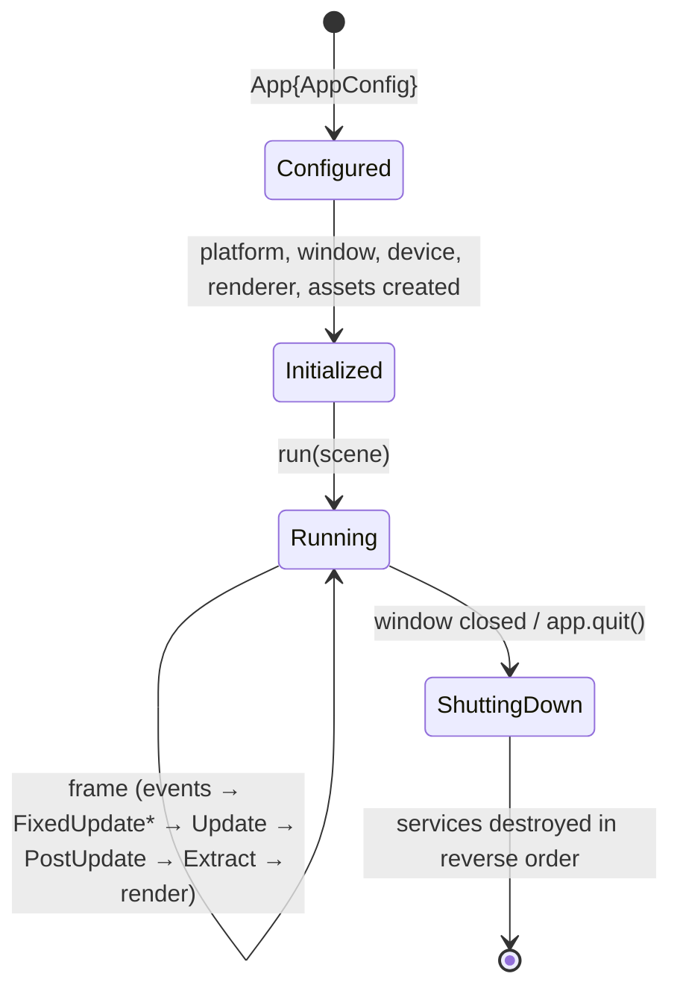

# Public API for game developers

This page describes how an indie developer uses Teserra: create an app, build scenes from entities and components, write systems, run the loop. The API is the product; every engine layer exists to make this page simple.

Related: [ECS](ecs.md), [renderer](renderer.md), [assets](assets.md), [overview](overview.md).

## Principles

1. **One include, one target.** `#include <teserra/teserra.hpp>` and `target_link_libraries(game PRIVATE Teserra::Engine)`. Lower-level headers stay available for advanced use.
2. **Plain data components, free-function systems.** No base classes to inherit, no virtual `update()`.
3. **Explicit context, no globals.** Systems receive a `SystemContext&` with the world, time, input, assets, debug draw and commands.
4. **Safe by default.** Handles instead of pointers, fallback assets instead of crashes, assertions with readable messages in debug builds.
5. **Small surface in v0.1.** Every public function is documented (`///` comments) and covered by an example or test. Anything not ready stays in a `detail` or `experimental` namespace.
6. **Stable within a minor version.** Breaking changes are listed in the changelog with migration notes ([release process](../process/release-process.md)).

## "Dream code": a tiny 2D game

This is the shape of the v0.1 API: a complete game in one file. **It compiles**: the build extracts this code block and compiles it as `teserra_public_api_example` (`tests/public_api/`), so the page cannot drift from the real API (#119). Issues that touch the public API check themselves against it and update it in the same PR.

```cpp
#include <teserra/teserra.hpp>

using namespace teserra;

// Components: plain data.
struct Player {
    f32 speed = 6.0F;
};
struct Coin {}; // a tag
struct Score {  // used as a world resource
    u32 value = 0;
};

// Systems: free functions that see the world through their context.
void movePlayer(ecs::SystemContext& ctx) {
    const auto& input = ctx.resource<const platform::Input>();
    const Vec2 direction = input.axis2D(platform::Key::A, platform::Key::D, platform::Key::S, platform::Key::W);
    const f32 dt = ctx.resource<const scene::Time>().deltaSeconds();
    for (auto [entity, transform, player] : ctx.view<scene::Transform, const Player>()) {
        transform.position += Vec3{direction * player.speed * dt, 0.0F};
    }
}

void collectCoins(ecs::SystemContext& ctx) {
    for (const auto [player, playerTransform, p] : ctx.view<const scene::Transform, const Player>()) {
        for (const auto [coin, coinTransform, tag] : ctx.view<const scene::Transform, const Coin>()) {
            if (math::length(coinTransform.position - playerTransform.position) < 0.5F) {
                ctx.commands().destroy(coin); // applied at the end of the phase
                ctx.resource<Score>().value += 1;
            }
        }
    }
}

int main(int argc, char** argv) {
    engine::App app{{.title = "Coin Hunt", .windowSize = {1280, 720}, .args = {argc, argv}}};

    scene::Scene& level = app.scenes().create("level");
    level.world().insertResource<Score>();

    // A missing file shows the magenta fallback texture and logs an error; the game keeps running.
    const auto heroTexture = app.assets().load<renderer::Texture>("assets://sprites/hero.png");
    const auto coinTexture = app.assets().load<renderer::Texture>("assets://sprites/coin.png");

    // Camera: 18 world units tall, orthographic.
    const ecs::Entity camera = level.spawn();
    level.add<scene::Transform>(camera);
    level.add<scene::Camera>(camera, scene::Camera{.projection = scene::Orthographic{.height = 18.0F}});

    const ecs::Entity hero = level.spawn();
    level.add<scene::Transform>(hero);
    level.add<scene::SpriteRenderer>(hero, scene::SpriteRenderer{.texture = heroTexture.get().handle(), .layer = 10});
    level.add<Player>(hero);

    for (int i = 0; i < 20; ++i) {
        const ecs::Entity coin = level.spawn();
        level.add<scene::Transform>(coin, scene::Transform{.position = {static_cast<f32>(i - 10), 4.0F, 0.0F}});
        level.add<scene::SpriteRenderer>(coin, scene::SpriteRenderer{.texture = coinTexture.get().handle(), .layer = 5});
        level.add<Coin>(coin);
    }

    level.systems()
        .add(ecs::Phase::Update, "move_player", movePlayer)
        .reads<Player>()
        .writes<scene::Transform>()
        .readsResource<platform::Input>()
        .readsResource<scene::Time>();
    level.systems()
        .add(ecs::Phase::Update, "collect_coins", collectCoins)
        .reads<scene::Transform>()
        .reads<Player>()
        .reads<Coin>()
        .writesResource<Score>()
        .after("move_player");

    return app.run(level); // the process exit code
}
```

Notes on the example:

- `#include <teserra/teserra.hpp>` brings in everything a game usually needs; names keep their namespaces (`engine::App`, `scene::Transform`, `ecs::SystemContext`), so it is always clear which layer a type belongs to.
- `Transform` is 3D even in 2D games (3D readiness); `Vec3{vec2, z}` keeps 2D code short.
- Input and time are world resources (`platform::Input`, `scene::Time`) that the App keeps current. Systems declare what they read and write, and debug builds assert on anything undeclared.
- A tag (`Coin`) joins a view like any component; `SystemContext::has<T>()` tests one entity.
- Destruction during iteration goes through `ctx.commands()`; the world changes at the end of the phase.
- Text on screen (a score display) waits for text rendering (#137); `examples/demo_game` draws its own pixel font meanwhile.
- `App::run` owns the main loop: events, fixed-step updates, variable updates, render extraction, rendering, presentation. It returns the exit code, 1 if initialization failed.
- The full game of this shape is `examples/demo_game`: menus, collisions with events, a tilemap and a HUD.

## Application lifecycle



- `AppConfig` covers window, vsync, fixed timestep, asset mount points, log levels and the RHI backend (default OpenGL).
- Today (`teserra_engine`, iteration 4) `App` owns the platform, the window and the `rhi::Device` (`AppConfig::backend`, default OpenGL; `std::nullopt` for no device) and runs the loop with `AppCallbacks` (`onEvent`, `fixedUpdate`, `update`, and `render`, which records into the frame's `rhi::CommandList` targeting `App::backbuffer()`) in place of scenes. Since iteration 10 it also owns the `scene::SceneManager` (`app.scenes()`), and `run(scene, callbacks)` makes a scene active, switches at frame boundaries, advances its `Time` resource, keeps its `platform::Input` resource current and runs its phases (Startup once, then PreUpdate, FixedUpdate per step, Update, PostUpdate, Extract, Last); without a render callback it draws what the scene's extraction produced. `examples/scene_sprites` and `examples/demo_game` are larger games of the same shape as the example above. The App submits the commands and presents; without `render`, it clears to black. While the window is minimized it is paused: each frame waits up to `AppConfig::minimizedEventWait` (100 ms) for window events instead of spinning, handles them (closing and `quit()` still work) and runs nothing else, so fixed steps, updates and scene phases stop and scene `Time` stands still; the frame that is restored resumes without catching up the pause. While a window border is dragged, the App runs a frame for each new size from inside the poll ([platform-abstraction.md](platform-abstraction.md), live resize), so the game is drawn at every size it passes through. The backends the build includes are linked through `OPTIONAL_DEPENDS` and passed to `rhi::createDevice()`. `App` also accepts an injected `platform::Platform`, which is how tests run it headless with a `ManualClock`. The engine flags `--frames N`, `--hidden-window` and `--debug-ui` in `AppConfig::args` are what example smoke runs use. Since iteration 11 the App also owns the asset mount points (`app.mounts()`, `AppConfig::mounts`; [assets.md](assets.md#mount-points-and-files)): `assets://` and `engine://` default to directories next to the executable, and a listed directory that does not exist fails initialization. It owns the asset registry too (`app.assets()`, [assets.md](assets.md#loaders)), with loaders for images and, with a device, textures and shaders, and unloads unused assets after each frame.
- **Debug UI** (#298, with `TESERRA_WITH_DEBUG_UI`): the App owns a `debugui::DebugUi` (`app.debugUi()`), opened and closed with the backtick key (`AppConfig::debugUi`: `enabled`, `toggleKey`, `startOpen`; `--debug-ui` starts it open; `app.setDebugUiOpen()`). The toggle key and the text it types never reach the game. While open, its frame starts after the events, so `ImGui::` calls work in the scene's phases from PreUpdate to Extract and in the callbacks other than `render`; then its windows are drawn and the App draws it over the frame's image with an overlay-only renderer of its own (`Renderer::renderOverlays()`), whether the scene renderer or a render callback drew the frame. While closed, frames run no ImGui at all. The App adds a **Stats** window (FPS, a graph of the last 120 frame times, fixed steps this frame, the active scene and its entity count, window and framebuffer sizes), a **Log** window (#299, `app.logConsole()`: the last 2000 messages, from any thread, with level, category and text filters), and **Entities** and **Inspector** windows (#300, `app.entityInspector()`: every scene's entities, and the selected one's components with their described fields, read-only); games add theirs with `app.debugUi().addWindow(name, function)`, and the View menu of its main menu bar lists every window. Mouse buttons and the wheel over its windows, and keys and text while one of its text fields has focus, do not reach `input()` or `onEvent` (releases always do). `TESERRA_WITH_DEBUG_UI` is a public compile definition of `teserra_engine` (0 or 1): `app.debugUi()` exists only when it is 1, so a game that builds both ways wraps its windows in `#if TESERRA_WITH_DEBUG_UI` (`examples/demo_game` does). `AppConfig::debugUi` exists either way.
- Failure during initialization (no GL 4.5 support, missing asset directory) returns a non-zero exit code from `run()` after logging a clear message; it does not throw.

## Advanced use

Developers who want lower layers can use them directly: create a `platform::Platform`, a window and an `rhi::Device`, and record command lists themselves (the `rhi_*` examples show this). The layering guarantees that these lower layers work without the ECS or the renderer.
