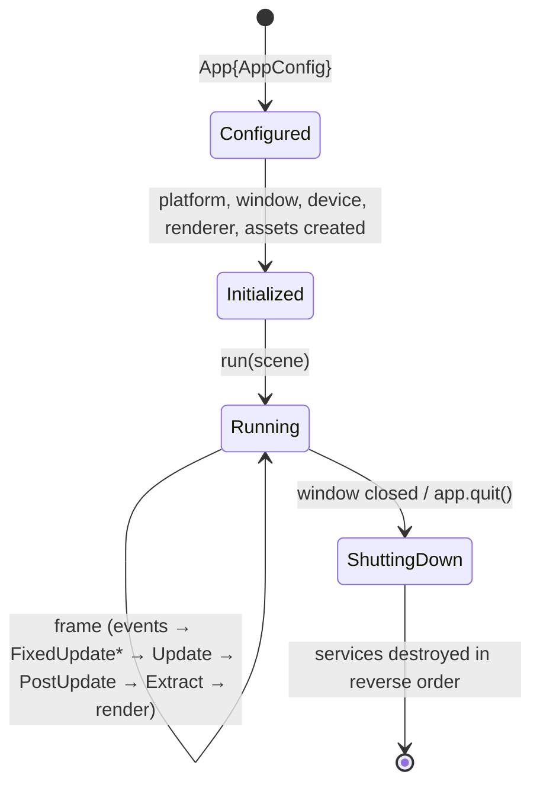

# Public API for game developers

This page describes how an indie developer uses Teserra: create an app, build scenes from entities and components, write systems, run the loop. The API is the product; every engine layer exists to make this page simple.

Related: [ECS](ecs.md), [renderer](renderer.md), [assets](assets.md), [overview](overview.md).

## Principles

1. **One include, one target.** `#include <teserra/teserra.hpp>` and `target_link_libraries(game PRIVATE Teserra::Engine)`. Lower-level headers stay available for advanced use.
2. **Plain data components, free-function systems.** No base classes to inherit, no virtual `update()`.
3. **Explicit context, no globals.** Systems receive a `SystemContext&` with the world, time, input, assets, debug draw and commands.
4. **Safe by default.** Handles instead of pointers, fallback assets instead of crashes, assertions with readable messages in debug builds.
5. **Small surface in v0.1.** Every public function is documented (`///` comments) and covered by an example or test. Anything not ready stays in a `detail` or `experimental` namespace.
6. **Stable within a minor version.** Breaking changes are listed in the changelog with migration notes ([release process](../process/release-process.md)).

## "Dream code": a tiny 2D game

This is the target shape of the v0.1 API, used as a design reference. Issues that touch the public API check themselves against it; when the real API diverges, this example is updated in the same PR.

```cpp
#include <teserra/teserra.hpp>

using namespace teserra;

// Components: plain data.
struct Player { f32 speed = 6.0f; };
struct Coin {};
struct Score { u32 value = 0; };   // used as a world resource

// Systems: free functions with an explicit context.
void movePlayer(SystemContext& ctx) {
    const Input& input = ctx.input();
    const Vec2 dir = input.axis2D(Key::A, Key::D, Key::S, Key::W);  // normalized
    for (auto [entity, transform, player] : ctx.view<Transform, const Player>()) {
        transform.position += Vec3{dir * player.speed * ctx.time().deltaSeconds(), 0.0f};
    }
}

void collectCoins(SystemContext& ctx) {
    auto players = ctx.view<const Transform, const Player>();
    for (auto [coin, coinTransform] : ctx.view<const Transform>(with<Coin>)) {
        for (auto [player, playerTransform, p] : players) {
            if (distance(coinTransform.position, playerTransform.position) < 0.5f) {
                ctx.commands().destroy(coin);
                ctx.resource<Score>().value += 1;
            }
        }
    }
    ctx.debugDraw().text2D({16, 16}, std::format("Score: {}", ctx.resource<Score>().value));
}

int main(int argc, char** argv) {
    App app{AppConfig{
        .title = "Coin Hunt",
        .windowSize = {1280, 720},
        .args = {argc, argv},
    }};

    Scene& level = app.scenes().create("level");
    level.world().insertResource<Score>();

    auto heroTexture = app.assets().load<Texture>("assets://sprites/hero.png");
    auto coinTexture = app.assets().load<Texture>("assets://sprites/coin.png");

    // Camera: 18 world units tall, orthographic.
    Entity camera = level.spawn();
    level.add<Transform>(camera);
    level.add<Camera>(camera, Camera{.projection = Orthographic{.height = 18.0f}});

    Entity hero = level.spawn();
    level.add<Transform>(hero, Transform{.position = {0.0f, 0.0f, 0.0f}});
    level.add<SpriteRenderer>(hero, SpriteRenderer{.texture = heroTexture, .layer = 10});
    level.add<Player>(hero);

    for (int i = 0; i < 20; ++i) {
        Entity coin = level.spawn();
        level.add<Transform>(coin, Transform{.position = {f32(i - 10), 4.0f, 0.0f}});
        level.add<SpriteRenderer>(coin, SpriteRenderer{.texture = coinTexture, .layer = 5});
        level.add<Coin>(coin);
    }

    level.systems().add(Phase::Update, "move_player", movePlayer)
        .reads<Player>().writes<Transform>();
    level.systems().add(Phase::Update, "collect_coins", collectCoins)
        .reads<Transform>().reads<Player>().reads<Coin>().writesResource<Score>()
        .after("move_player");

    return app.run(level);   // returns the process exit code
}
```

Notes on the example:

- `Transform` is 3D even in 2D games (3D readiness); 2D helpers (`Vec3{vec2, z}`) keep it short.
- Destruction during iteration goes through `ctx.commands()`; the world is changed at the end of the phase.
- `text2D` is a v0.2 debug-draw feature (text rendering is in the backlog) and appears here to show intended direction.
- `App::run` owns the main loop: events, fixed-step updates, variable updates, render extraction, rendering, presentation.

## Application lifecycle



- `AppConfig` covers window, vsync, fixed timestep, asset mount points, log levels and the RHI backend (default OpenGL).
- Today (`teserra_engine`, iteration 3) `App` owns the platform and the window and runs the loop with `AppCallbacks` (`onEvent`, `fixedUpdate`, `update`) in place of scenes; `run(scene)` replaces them in iteration 10. `App` also accepts an injected `platform::Platform`, which is how tests run it headless with a `ManualClock`. The engine flags `--frames N` and `--hidden-window` in `AppConfig::args` are what example smoke runs use.
- Failure during initialization (no GL 4.5 support, missing asset directory) returns a non-zero exit code from `run()` after logging a clear message; it does not throw.

## Advanced use

Developers who want lower layers can use them directly: create a `platform::Platform`, a window and an `rhi::Device`, and record command lists themselves (the `rhi_*` examples show this). The layering guarantees that these lower layers work without the ECS or the renderer.
