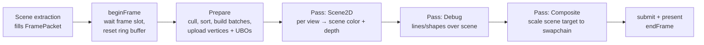

# Renderer

The renderer turns plain render data into RHI command lists. It is built **only on the RHI**: it never sees a backend, a window system or the ECS. v1 renders 2D content (sprites, tilemaps, debug shapes); every structure is chosen so a 3D renderer can be added beside it without changing the foundation.

Related: [RHI](rhi.md), [ADR-0024 conventions](../adr/0024-coordinate-conventions.md), [ADR-0017 shaders](../adr/0017-shader-pipeline.md), [assets](assets.md), [ECS](ecs.md).

## Scope

| v1 (v0.1) | Future |
|---|---|
| Frame structure with frames in flight and per-frame upload ring buffers | Render graph with automatic resource lifetimes and barriers (v2) |
| Ordered pass list (scene 2D, debug, composite) | 3D passes: depth prepass, opaque, transparent, shadows, post-processing (v2) |
| Camera with orthographic **and** perspective projection (perspective tested, not used by 2D features) | Multiple views per frame for split screen, minimaps (data model already supports a list) |
| Sprite batcher, tilemap chunk rendering | Instanced sprites, particles, text rendering (v0.2+) |
| Materials: shader + pipeline state + parameters + textures | Material graphs, PBR materials (v2) |
| Offscreen render targets, composite to swapchain with integer scaling | HDR, tone mapping, MSAA |
| Debug draw (lines, rectangles, circles, 3D-capable) | Debug draw for meshes, gizmos (editor) |

## Inputs: render data, not entities

The scene layer **extracts** what is visible into a `FramePacket`, a set of plain arrays the renderer owns and reuses each frame:

```cpp
struct RenderView {             // one per camera that renders this frame
    CameraData camera;          // view, projection, viewProjection, position, viewport
    RenderTargetHandle target;  // null = main scene target
    Color clearColor;
    i32 order;                  // views render in ascending order
};

struct SpriteDrawItem {
    Mat4 world;                 // full 3D transform (2D uses z = 0 plane)
    UvRect uv;                  // top-left origin
    Vec2 size;                  // world units
    Vec2 pivot;                 // normalized
    Color tint;
    MaterialInstanceHandle material;   // default sprite material if null
    TextureHandle texture;
    i16 layer;                  // explicit sort layer
    f32 sortDepth;              // tie-breaker inside a layer (e.g. -y for top-down games)
};

struct FramePacket {
    std::vector<RenderView> views;
    std::vector<SpriteDrawItem> sprites;
    std::vector<TilemapChunkDrawItem> tilemapChunks;
    DebugDrawList debug;
    // future: meshes, lights, particles
};
```

This keeps the renderer testable (fill a packet by hand, render with the null backend, inspect commands) and lets extraction move to another thread later.

## Frame structure



- `Renderer::render(const FramePacket&)` runs prepare + passes and submits one command list per frame in v1.
- **Frame context** per frame slot (`kMaxFramesInFlight = 2`): an upload ring buffer partition, the frame's view uniform data, transient bind groups. Reset in `beginFrame()` after the RHI fence for that slot completes.
- **Passes** implement a small interface:

  ```cpp
  class RenderPass {
  public:
      virtual ~RenderPass() = default;
      virtual std::string_view name() const = 0;
      virtual void declare(PassBuilder& builder) = 0;  // reads/writes of named targets
      virtual void execute(PassContext& ctx, rhi::CommandList& cmd) = 0;
  };
  ```

  In v1 passes run in the order they were added and `declare()` is used only for validation and debug labeling. A future render graph uses the same declarations to order passes, alias transient targets and insert barriers, so v1 passes do not need rewriting.
- Every pass wraps its commands in `cmd.pushDebugGroup(name())` for GPU debuggers and profiling.

## Cameras

```cpp
struct Orthographic { f32 height = 10.0f; f32 nearPlane = -100.0f; f32 farPlane = 100.0f; };
struct Perspective  { f32 fovYRadians = 1.0472f; f32 nearPlane = 0.1f; f32 farPlane = 1000.0f; };

struct Camera {
    std::variant<Orthographic, Perspective> projection = Orthographic{};
    Rect viewport = {0, 0, 1, 1};     // normalized, top-left origin
    i32 order = 0;
    Color clearColor = Color::black();
    RenderTargetHandle target;        // null = main scene target
};
```

- The view matrix comes from the camera's world transform (`inverse(world)`); the projection from the variant and the target's aspect ratio. Matrices follow [ADR-0024](../adr/0024-coordinate-conventions.md): right-handed, depth `[0, 1]`.
- `CameraData` (std140-compatible, set 0, binding 0): `view`, `projection`, `viewProjection`, `inverseViewProjection`, `cameraPosition`, `viewportSize`, `time`. A `static_assert` on size/offsets mirrors the shader-side block.
- 2D helpers: `Camera2D` utilities for zoom, pixel-perfect snapping (`pixelsPerUnit`, integer zoom), `screenToWorld` / `worldToScreen`.
- Perspective is part of v1 **and covered by a unit test** (projection of known points, depth range) so 3D work starts from a verified camera.

## Sprite batcher

Goal: draw tens of thousands of sprites with few draw calls and **zero heap allocations per frame** after warm-up.

1. **Sort.** Each `SpriteDrawItem` gets a 64-bit sort key: `layer (16 bits) | sortDepth quantized (24 bits) | material/texture batch id (24 bits)`. Sorting is a radix or `std::sort` over keys + indices in a reused array. Transparent sprites are drawn back-to-front by construction; the depth attachment exists (3D readiness) but sprite materials default to depth test off, depth write off.
2. **Batch.** Consecutive items with the same material instance and texture form a batch. A batch breaks when either changes or when the vertex budget of a batch is reached.
3. **Expand.** For each sprite, four vertices are written directly into the frame's upload ring buffer: `position: Float3`, `uv: Float2`, `color: Unorm8x4` (24 bytes). Positions are transformed on the CPU from the full 3D world matrix.
4. **Draw.** A static index buffer holds the quad pattern for the maximum batch size (16-bit indices, 16 383 quads per batch). Each batch is one `drawIndexed` with a vertex offset.

The vertex layout is declared as an RHI `VertexLayout`, never hard-coded in the RHI. CPU expansion is the simplest correct approach; **instanced** sprites (per-instance data + vertex pulling) are a benchmark-driven optimization in the backlog.

## Tilemaps

Tilemaps are rendered as **chunks** (e.g. 32×32 tiles). Each chunk owns a static vertex buffer built once and rebuilt only when tiles in that chunk change. Chunks are culled against the view's bounds and drawn with the tileset's material. Details of the data model live with the scene layer; the renderer only sees `TilemapChunkDrawItem {world, vertexBuffer, indexCount, material, layer}`.

## Materials, shaders and uniforms

- A **Shader** asset pairs vertex and fragment `.tshader` modules plus their reflection data.
- A **Material** = shader + pipeline state template (blend mode, depth test/write, cull mode) + parameter block layout (derived from reflection of set 2) + default values.
- A **MaterialInstance** = material + parameter values + textures. It owns one parameter uniform buffer region and a bind group for set 2. Changing a parameter marks it dirty; the buffer is rewritten during prepare.
- **Pipelines are created lazily** and cached by `(material pipeline state, vertex layout, render target layout)`. Pipeline creation is never on the per-sprite path; a frame that creates a pipeline logs it at `Debug` level so warm-up issues are visible.
- **Uniform data** is uploaded through buffers only: per-frame (set 0), per-material (set 2), per-draw via dynamic offsets into the ring buffer (set 3). C++ mirror structs use explicit `alignas` and `static_assert` against reflection sizes.
- Built-in materials in v1: `sprite_unlit` (texture × tint, blend modes alpha / premultiplied / additive), `debug_lines`, `composite`.

## Render targets

- `RenderTarget` = color texture(s) + optional depth texture + size + formats, owned by the renderer and referenced by `RenderTargetHandle`.
- Size policies: **match swapchain** (default) or **fixed resolution** (pixel-art games render at e.g. 320×180 and the composite pass scales by the largest integer factor, letterboxing the rest).
- The main scene target always has a depth attachment (`Depth32Float`), even though v1 2D materials rarely use it.

## Debug draw

Immediate-mode API available to systems through the frame context:

```cpp
debug.line(Vec3 a, Vec3 b, Color c);
debug.rect(const Rect& r, Color c, f32 z = 0.0f);
debug.circle(Vec3 center, f32 radius, Color c, u32 segments = 32);
debug.cross(Vec3 p, f32 size, Color c);
```

Shapes accumulate in a `DebugDrawList` (line vertices in 3D) and are drawn in the debug pass with an option for depth testing. Debug draw can be disabled at runtime and compiled out with `TESERRA_WITH_DEBUG_DRAW=OFF`.

## 3D readiness checklist

Apply this checklist to **every** 2D renderer or scene feature. Issues that touch rendering quote the relevant rows in their acceptance criteria.

| # | Rule | How v1 satisfies it | Review question |
|---|---|---|---|
| 1 | Transforms are 3D | `Transform` = `Vec3` position, `Quat` rotation, `Vec3` scale; `Mat4` world matrices | Does the feature store or accept only 2D transforms? |
| 2 | Vertex formats are data | Every vertex format is an RHI `VertexLayout`; positions are `Float3` | Is a 2D vertex struct assumed by the RHI or a shared shader? |
| 3 | Depth exists | Scene targets have depth attachments; pipeline depth state is explicit | Would adding depth testing require API changes? |
| 4 | Culling is bounds-based | Visibility uses `Aabb` (3D) against view bounds; 2D boxes have zero thickness | Is culling hard-coded to screen rectangles? |
| 5 | Cameras are general | Projection is a variant (ortho/perspective); view from transform | Does code assume an orthographic camera? |
| 6 | Sorting is key-based | 64-bit sort keys; layers are a key field, not a separate code path | Could opaque front-to-back / transparent back-to-front fit the same mechanism? |
| 7 | Materials are generic | Parameters come from reflection; no sprite-specific fields in `Material` | Does the material type know what a sprite is? |
| 8 | Assets are generic | Loaders are registered per type; textures/shaders are not special-cased | Could a mesh loader be added without touching the registry? |
| 9 | Conventions hold | Right-handed Y-up, depth `[0, 1]`, top-left UVs ([ADR-0024](../adr/0024-coordinate-conventions.md)) | Does the feature flip Y or remap depth itself? |
| 10 | No backend leaks | Only RHI types used ([rhi.md](rhi.md#what-must-not-leak-out-of-the-rhi)) | Does the feature need to know which backend runs? |

## Performance targets (v1)

- 10 000 moving sprites with 16 textures at 60 FPS on an integrated GPU (reference machine documented in [memory and performance](memory-and-performance.md#v1-performance-budget)).
- Zero heap allocations in `Renderer::render()` in steady state (verified by an allocation-counting test).
- Draw calls: one per batch; a scene with a single texture atlas renders in a handful of draws.
