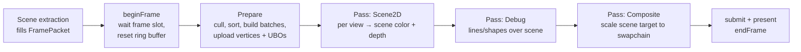

# Renderer

The renderer turns plain render data into RHI command lists. It is built **only on the RHI**: it never sees a backend, a window system or the ECS. v1 renders 2D content (sprites, tilemaps, debug shapes); every structure is chosen so a 3D renderer can be added beside it without changing the foundation.

Related: [RHI](rhi.md), [ADR-0024 conventions](../adr/0024-coordinate-conventions.md), [ADR-0017 shaders](../adr/0017-shader-pipeline.md), [assets](assets.md), [ECS](ecs.md).

## Scope

| v1 (v0.1) | Future |
|---|---|
| Frame structure with frames in flight and per-frame upload ring buffers | Render graph with automatic resource lifetimes and barriers (v2) |
| Ordered pass list (scene 2D, debug, composite) | 3D passes: depth prepass, opaque, transparent, shadows, post-processing (v2) |
| Camera with orthographic **and** perspective projection (perspective tested, not used by 2D features) | Multiple views per frame for split screen, minimaps (data model already supports a list) |
| Sprite batcher, tilemap chunk rendering | Instanced sprites, particles, text rendering (v0.2+) |
| Materials: shader + pipeline state + parameters + textures | Material graphs, PBR materials (v2) |
| Offscreen render targets, composite to swapchain with integer scaling | HDR, tone mapping, MSAA |
| Debug draw (lines, rectangles, circles, 3D-capable) | Debug draw for meshes, gizmos (editor) |

## Inputs: render data, not entities

The scene layer **extracts** what is visible into a `FramePacket`, a set of plain arrays the renderer owns and reuses each frame:

```cpp
struct RenderView {             // one per camera that renders this frame
    CameraData camera;          // view, projection, viewProjection, position, viewport
    RenderTargetHandle target;  // null = main scene target
    Color clearColor;
    i32 order;                  // views render in ascending order
};

struct SpriteDrawItem {
    Mat4 world;                 // full 3D transform (2D uses z = 0 plane)
    UvRect uv;                  // top-left origin
    Vec2 size;                  // world units
    Vec2 pivot;                 // normalized like UVs: {0, 0} = the image's top-left corner
    Color tint;                 // linear
    TextureHandle texture;
    SpriteBlend blend;          // Alpha, Premultiplied, Additive; a MaterialInstanceHandle replaces it (#97)
    i16 layer;                  // explicit sort layer
    f32 sortDepth;              // tie-breaker inside a layer (e.g. -y for top-down games)
};

struct FramePacket {
    std::vector<RenderView> views;
    std::vector<SpriteDrawItem> sprites;
    std::vector<TilemapChunkDrawItem> tilemapChunks;
    DebugDrawList debug;
    // future: meshes, lights, particles
};
```

This keeps the renderer testable (fill a packet by hand, render with the null backend, inspect commands) and lets extraction move to another thread later.

Today the scene layer's extraction system fills the views and sprites from `scene::Camera` and `scene::SpriteRenderer` components, culling sprites whose 3D bounds miss every view's bounds, and `engine::App` renders the active scene's packet ([ECS: scenes own worlds](ecs.md#scenes-own-worlds)). The renderer itself still sees no entity: the layer check keeps ECS types out of it.

## Frame structure



- `Renderer::render(const FramePacket&, const FrameTarget&, rhi::CommandList&)` records the frame into a command list it is given: `engine::App` owns `beginFrame()`, submission and present, so the renderer records between them. It starts the frame's upload memory, uploads each view's `CameraData`, then runs the passes. Views are sorted by `order` (stable).
- **Upload ring** (`UploadRing`): one persistently mapped `Upload` buffer (`Uniform | Vertex | Index | CopySrc`) with a partition of `RendererConfig::uploadBytesPerFrame` (default 4 MiB, rounded up to 256) per frame slot. `beginFrame()` takes `Device::frameSlot()` and empties that partition, which the GPU no longer reads once the device's `beginFrame()` has waited for the slot; `allocate(size, alignment)` sub-allocates from it. It asserts when the partition is full and when the device has moved to another slot without the ring's `beginFrame()`, which would write into data still in flight.
- **Frame bind group** (set 0, `rhi::kFrameGroup`): one group over the whole ring with the view's `CameraData` (288 bytes, std140) as a uniform buffer with a dynamic offset. `PassContext::bindView(cmd, view)` binds it with the view's offset; pipelines of passes put `Renderer::frameGroupLayout()` at set 0.
- **Frame context** per frame slot (`kMaxFramesInFlight = 2`): an upload ring buffer partition, the frame's view uniform data, transient bind groups. Reset in `beginFrame()` after the RHI fence for that slot completes.
- **Passes** implement a small interface:

  ```cpp
  class RenderPass {
  public:
      virtual ~RenderPass() = default;
      virtual std::string_view name() const = 0;
      virtual void declare(PassBuilder& builder) = 0;  // reads/writes of named targets
      virtual void execute(PassContext& ctx, rhi::CommandList& cmd) = 0;
  };
  ```

  In v1 passes run in the order they were added and `declare()` is used only for validation and debug labeling: `PassBuilder::reads()` / `writes()` take a `PassResource` (v1: `SceneColor`, the frame's `FrameTarget`), and `PassContext::target(resource)` asserts that the running pass declared it. A future render graph uses the same declarations to order passes, alias transient targets and insert barriers, so v1 passes do not need rewriting.
- Every pass wraps its commands in `cmd.pushDebugGroup(name())` for GPU debuggers and profiling.

## Cameras

```cpp
struct Orthographic { f32 height = 10.0f; f32 nearPlane = -100.0f; f32 farPlane = 100.0f; };
struct Perspective  { f32 fovYRadians = 1.0472f; f32 nearPlane = 0.1f; f32 farPlane = 1000.0f; };

struct Camera {
    std::variant<Orthographic, Perspective> projection = Orthographic{};
    Rect viewport{.position = Vec2{0.0F}, .size = Vec2{1.0F}};  // normalized, top-left origin
    i32 order = 0;
    Color clearColor{.r = 0.0F, .g = 0.0F, .b = 0.0F, .a = 1.0F};
    // render target: with render targets (#95); the frame's target until then
};
```

`<teserra/renderer/camera.hpp>` builds a view from a camera and its world transform: `projectionMatrix(camera, aspect)`, `cameraData(camera, world, targetSize, time)` and `renderView(camera, world, targetSize, time)` (camera data plus order and clear color, for the `FramePacket`). `worldToScreen(cameraData, point)` and `screenToWorld(cameraData, pixel, depth)` convert between world points and viewport pixels (top-left origin, depth `[0, 1]`) through `viewProjection` and its inverse, for either projection.

- The view matrix comes from the camera's world transform (`inverse(world)`); the projection from the variant and the target's aspect ratio. Matrices follow [ADR-0024](../adr/0024-coordinate-conventions.md): right-handed, depth `[0, 1]`.
- `CameraData` (std140-compatible, set 0, binding 0, 288 bytes): `view`, `projection`, `viewProjection`, `inverseViewProjection`, `position`, `viewportSize`, `time`. `static_assert`s on size and offsets mirror the shader-side block, which engine shaders include from `engine/renderer/shaders/teserra/camera.glsl` (`#include <teserra/camera.glsl>`); a test compiles a shader with it and compares the reflected std140 size with `sizeof(CameraData)`.
- 2D helpers: `Camera2D { position, zoom, pixelsPerUnit, pixelSnap }` makes an orthographic camera (`camera(viewportSize)`, `world()`) whose height is `viewportSize.y / (pixelsPerUnit * zoom)`, so each texel of art drawn at `pixelsPerUnit` shows as `zoom` screen pixels. `pan(delta)`, `zoomAt(factor, cursor, viewportSize)` (the world point under the cursor stays put), `screenToWorld` / `worldToScreen`, and `pixelSnap`, which rounds the view position to whole screen pixels so pixel art does not shimmer while the camera moves.
- Perspective is part of v1 **and covered by a unit test** (projection of known points, depth range) so 3D work starts from a verified camera.

## Sprite batcher

Goal: draw tens of thousands of sprites with few draw calls and **zero heap allocations per frame** after warm-up.

1. **Sort.** Each `SpriteDrawItem` gets a 64-bit sort key (`spriteSortKey()`): `layer (16 bits, biased so negative layers come first) | sortDepth quantized (24 bits, through the float's order-preserving bit pattern) | batch id (24 bits: texture slot index and blend)`. `SpriteBatcher::prepare()` sorts (key, index) pairs with `std::sort` in a reused array; the index breaks ties, so equal keys keep their input order and frames do not flicker. A radix sort stays a measured optimization. Transparent sprites are drawn back-to-front by construction; the depth attachment exists (3D readiness) but sprite materials default to depth test off, depth write off.
2. **Batch.** Consecutive items with the same material instance and texture form a batch. A batch breaks when either changes or when the vertex budget of a batch is reached.
3. **Expand.** For each sprite, `SpriteBatcher::writeVertices()` writes four `SpriteVertex`es in draw order directly into the frame's upload ring buffer: `position: Float3`, `uv: Float2`, `color: Unorm8x4` (24 bytes; `kSpriteVertexBuffer` and `kSpriteVertexAttributes` describe it as RHI data). The corners go top-left, bottom-left, bottom-right, top-right, counter-clockwise with +Y up for the index pattern `0 1 2, 0 2 3`. Positions are transformed on the CPU from the full 3D world matrix; the tint is stored as linear bytes. `SpriteBatch { texture, blend, firstSprite, spriteCount }` gives each draw's first vertex as `firstSprite * 4`.
4. **Draw.** A static index buffer holds the quad pattern for the maximum batch size (16-bit indices, 16 383 quads per batch). Each batch is one `drawIndexed` with a vertex offset.

`SpritePass` (`<teserra/renderer/sprite_pass.hpp>`, `SpritePass::create(device, renderer.frameGroupLayout(), {filter})`) does all four with the built-in `sprite_unlit` material (texture × tint; shaders embedded in `teserra_renderer`). It declares `writes(SceneColor)`, clears it to the first view's clear color, and for every view sets the viewport and scissor from `RenderView::viewport`, binds the view's camera (set 0), the frame's vertices from one ring allocation and the static index buffer, then per batch binds the pipeline only when the blend mode changes and the texture's material group (set 2) only when the texture changes. Pipelines (per target format and blend mode) and one bind group per texture are created on first use and kept, so a steady-state frame creates no GPU objects; `forgetTexture()` drops a texture's group before the texture is destroyed. `stats()` reports sprites, batches and draw calls of the last frame. `examples/sprite_stress` draws 1 000 or 10 000 sprites with 16 textures in 16 draws.

The vertex layout is declared as an RHI `VertexLayout`, never hard-coded in the RHI. CPU expansion is the simplest correct approach; **instanced** sprites (per-instance data + vertex pulling) are a benchmark-driven optimization in the backlog.

## Tilemaps

Tilemaps are rendered as **chunks** (e.g. 32×32 tiles). Each chunk owns a static vertex buffer built once and rebuilt only when tiles in that chunk change. Chunks are culled against the view's bounds and drawn with the tileset's material. Details of the data model live with the scene layer; the renderer only sees `TilemapChunkDrawItem {world, vertexBuffer, indexCount, material, layer}`.

The data model (`<teserra/scene/tilemap.hpp>`, #88):

- A `Tilemap` component has a `tileSize` in world units and `layers`, drawn in order. Tile (x, y) covers `[x, x + 1) × [y, y + 1)` times `tileSize` in the entity's local space, +Y up (ADR-0024); Tiled's row-down maps are flipped by the importer.
- A `TilemapLayer` stores `TileId`s (`u32`; 0 = `kNoTile`, n = tile n - 1 of the tileset, Tiled's gid without flip bits) in 32×32 `TilemapChunk`s in a hash map keyed by chunk coordinate (`chunkOf()`, floor division, so negative coordinates work). Chunks without tiles are never allocated; a chunk emptied by edits stays allocated so the renderer sees the change.
- `setTile()` marks a chunk `dirty` only when a value changes; the renderer rebuilds dirty chunks and calls `clearDirty()`.
- A `Tileset` (with the renderer) is a `SpriteSheet` plus per-tile `TileProperties` (`solid`); tiles without properties get the defaults.
- Gameplay asks the map through a `TilemapQuery` (`<teserra/scene/tile_queries.hpp>`, #91): the map plus its entity's world matrix. `tileAt(layer, worldPos)` reads the tile under a point; `tilesOverlapping(layer, box, f)` visits the tiles whose inside a world box overlaps, chunk by chunk, with a callback, so queries never allocate. A box that only touches a tile's edge does not reach it, so a body resting on the ground does not overlap it. `isSolidAt()` and `overlapsSolid()` combine a query with a `Tileset`'s `solid` property.

## Materials, shaders and uniforms

- A **Shader** asset (`renderer::Shader`, #81) is one compiled stage: the shader module of a `.tshader` blob and its stage; the blob carries the reflection. A material names its vertex and fragment shaders.
- A **Material** = shader + pipeline state template (blend mode, depth test/write, cull mode) + parameter block layout (derived from reflection of set 2) + default values.
- A **MaterialInstance** = material + parameter values + textures. It owns one parameter uniform buffer region and a bind group for set 2. Changing a parameter marks it dirty; the buffer is rewritten during prepare.
- **Pipelines are created lazily** and cached by `(material pipeline state, vertex layout, render target layout)`. Pipeline creation is never on the per-sprite path; a frame that creates a pipeline logs it at `Debug` level so warm-up issues are visible.
- **Uniform data** is uploaded through buffers only: per-frame (set 0), per-material (set 2), per-draw via dynamic offsets into the ring buffer (set 3). C++ mirror structs use explicit `alignas` and `static_assert` against reflection sizes.
- Built-in materials in v1: `sprite_unlit` (texture × tint, blend modes alpha / premultiplied / additive), `debug_lines`, `composite`.

## Render targets

- `RenderTarget` = color texture(s) + optional depth texture + size + formats, owned by the renderer and referenced by `RenderTargetHandle`.
- Size policies: **match swapchain** (default) or **fixed resolution** (pixel-art games render at e.g. 320×180 and the composite pass scales by the largest integer factor, letterboxing the rest).
- The main scene target always has a depth attachment (`Depth32Float`), even though v1 2D materials rarely use it.

## Debug draw

Immediate-mode API available to systems through the frame context:

```cpp
debug.line(Vec3 a, Vec3 b, Color c);
debug.rect(const Rect& r, Color c, f32 z = 0.0f);
debug.circle(Vec3 center, f32 radius, Color c, u32 segments = 32);
debug.cross(Vec3 p, f32 size, Color c);
```

Shapes accumulate in a `DebugDrawList` (line vertices in 3D) and are drawn in the debug pass with an option for depth testing. Debug draw can be disabled at runtime and compiled out with `TESERRA_WITH_DEBUG_DRAW=OFF`.

## 3D readiness checklist

Apply this checklist to **every** 2D renderer or scene feature. Issues that touch rendering quote the relevant rows in their acceptance criteria.

| # | Rule | How v1 satisfies it | Review question |
|---|---|---|---|
| 1 | Transforms are 3D | `Transform` = `Vec3` position, `Quat` rotation, `Vec3` scale; `Mat4` world matrices | Does the feature store or accept only 2D transforms? |
| 2 | Vertex formats are data | Every vertex format is an RHI `VertexLayout`; positions are `Float3` | Is a 2D vertex struct assumed by the RHI or a shared shader? |
| 3 | Depth exists | Scene targets have depth attachments; pipeline depth state is explicit | Would adding depth testing require API changes? |
| 4 | Culling is bounds-based | Visibility uses `Aabb` (3D) against view bounds; 2D boxes have zero thickness | Is culling hard-coded to screen rectangles? |
| 5 | Cameras are general | Projection is a variant (ortho/perspective); view from transform | Does code assume an orthographic camera? |
| 6 | Sorting is key-based | 64-bit sort keys; layers are a key field, not a separate code path | Could opaque front-to-back / transparent back-to-front fit the same mechanism? |
| 7 | Materials are generic | Parameters come from reflection; no sprite-specific fields in `Material` | Does the material type know what a sprite is? |
| 8 | Assets are generic | Loaders are registered per type; textures/shaders are not special-cased | Could a mesh loader be added without touching the registry? |
| 9 | Conventions hold | Right-handed Y-up, depth `[0, 1]`, top-left UVs ([ADR-0024](../adr/0024-coordinate-conventions.md)) | Does the feature flip Y or remap depth itself? |
| 10 | No backend leaks | Only RHI types used ([rhi.md](rhi.md#what-must-not-leak-out-of-the-rhi)) | Does the feature need to know which backend runs? |

## Performance targets (v1)

- 10 000 moving sprites with 16 textures at 60 FPS on an integrated GPU (reference machine documented in [memory and performance](memory-and-performance.md#v1-performance-budget)).
- Zero heap allocations in `Renderer::render()` in steady state (verified by an allocation-counting test).
- Draw calls: one per batch; a scene with a single texture atlas renders in a handful of draws.
