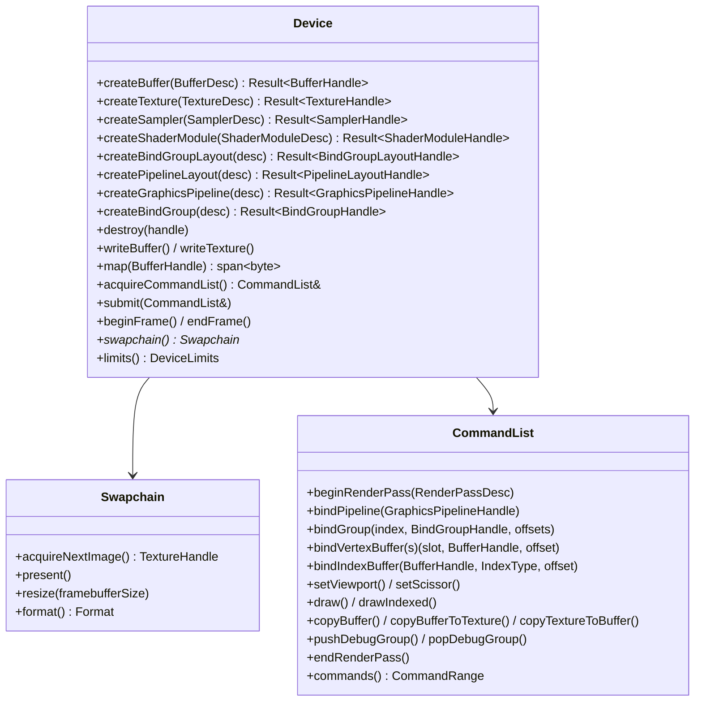
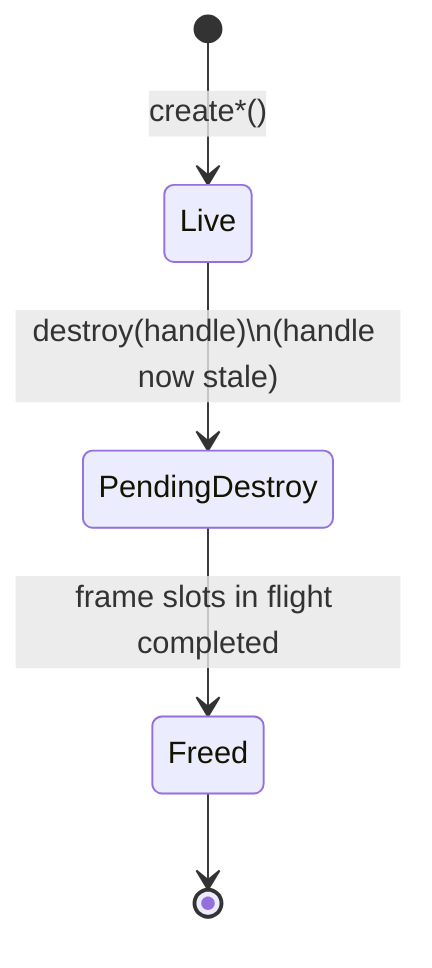
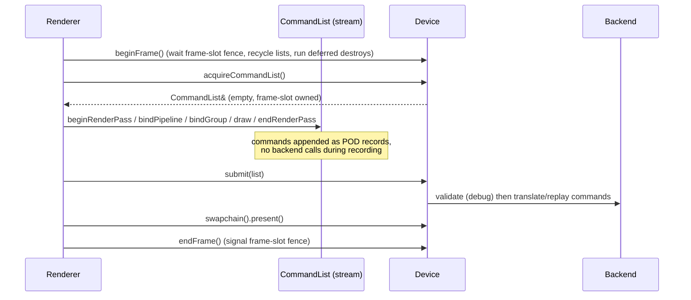

# Render Hardware Interface (RHI)

The RHI is the only way the engine talks to the GPU. It is shaped like Vulkan, D3D12 and Metal (explicit objects, baked pipelines, recorded command lists, descriptor-set-style binding), and implemented first on OpenGL 4.5. Decisions: [ADR-0005](../adr/0005-explicit-rhi-design.md), [ADR-0004](../adr/0004-opengl-45-dsa-first-backend.md), [ADR-0017](../adr/0017-shader-pipeline.md), [ADR-0020](../adr/0020-generational-handles.md), [ADR-0024](../adr/0024-coordinate-conventions.md).

> Everything above the [OpenGL backend mapping](#opengl-backend-mapping) section is backend-neutral. If you find a GL-ism above that line, it is a bug in this document.

## Scope

| v1 (v0.1) | Future |
|---|---|
| Graphics pipelines (vertex + fragment), buffers, 2D/2D-array textures, samplers, bind groups, render passes with load/store ops, swapchain, fences, uploads, readback, debug markers | Compute pipelines and storage textures, push constants, MSAA resolve, texture views, cube/3D textures in practice, timestamp queries, multiple queues, bindless resources, explicit barriers / render graph integration, multithreaded recording |
| Backends: OpenGL 4.5, null | Vulkan 1.3, possibly Metal / D3D12 |

v1 *defines* some future concepts (3D texture dimension, depth formats, perspective-ready pipeline state, instance step rate) so that adding them later does not change existing signatures. Every v1 feature must still be exercised by an example or a test.

## Objects



| Object | Purpose | Mutable after creation? |
|---|---|---|
| `Device` | Factory and owner of all resources; submission; frame pacing | - |
| `Swapchain` | Presentable images for a window | Resized via `resize()` |
| `Buffer` | Linear memory: vertex, index, uniform, storage, readback | Contents only |
| `Texture` | Images: sampled, render target, depth-stencil | Contents only |
| `Sampler` | Filtering and addressing state | No |
| `ShaderModule` | One compiled shader stage (`.tshader` blob) | No |
| `BindGroupLayout` | Shape of a resource group (≈ `VkDescriptorSetLayout`) | No |
| `PipelineLayout` | Ordered list of bind group layouts (+ push constants, future) | No |
| `GraphicsPipeline` | Shaders + vertex layout + all fixed-function state + target formats | No |
| `BindGroup` | Concrete resources matching a layout (≈ `VkDescriptorSet`) | No (create a new one) |
| `CommandList` | Recorded GPU work for one submission | Reset per frame |
| `Fence` | CPU-GPU synchronization point | Signaled/reset by device |

## Conventions

The RHI contract (all backends): clip-space depth `[0, 1]`; NDC +Y up; **top-left origin** for render targets, textures, viewports, scissors, uploads and readbacks; counter-clockwise front faces. See [ADR-0024](../adr/0024-coordinate-conventions.md). Backends are responsible for honoring this contract; the renderer never compensates for a backend.

## Handles and resource lifetime

- All objects are referenced by typed generational handles (`BufferHandle`, `TextureHandle`, ...). Null handle = default-constructed.
- `Device::destroy(handle)` invalidates the handle **immediately** (CPU side). The backend **defers** destruction of the underlying GPU object until every frame that may still use it has completed (tracked per frame slot, `kMaxFramesInFlight = 2`).
- `rhi::Unique<THandle>` is a move-only RAII owner (handle + `Device&`) for code that wants scope-based lifetime. Containers of resources (materials, render targets) own handles explicitly and destroy them in their destructors.
- Descriptor structs carry an optional `debugName` that backends forward to their debug-labeling facility and that validation messages print.



## Device creation and backend selection

```cpp
namespace teserra::rhi {

enum class Backend : u8 { OpenGL, Vulkan, Null };

struct DeviceDesc {
    Backend backend = Backend::OpenGL;
    bool enableValidation = TESERRA_DEBUG_BUILD != 0;   // RHI-level validation, see below
    bool enableBackendDebug = TESERRA_DEBUG_BUILD != 0; // driver debug output / validation layers
    SwapchainDesc swapchain{};                          // preferred format, present mode
};

// What each backend library exports, e.g. rhi::null::backendFactory().
struct BackendFactory {
    Backend backend = Backend::Null;
    Result<std::unique_ptr<Device>> (*create)(const DeviceDesc& desc, platform::Window* window) = nullptr;
};

// Uses the factory for desc.backend; `window` is null for a headless device (no swapchain).
[[nodiscard]] Result<std::unique_ptr<Device>> createDevice(const DeviceDesc& desc, platform::Window* window,
                                                           std::span<const BackendFactory> backends);

} // namespace teserra::rhi
```

- Backends are compiled in by CMake options (`TESERRA_RHI_OPENGL=ON`, `TESERRA_RHI_VULKAN=OFF`, null always on for tests). `teserra_engine` passes the factories of the compiled-in backends to `createDevice()`; tests pass the ones they need. Asking for a backend that is not among them returns an `Error` (`Unsupported`).
- Backends do not register themselves: a self-registering object in a static library is dropped by the linker when nothing references it, and a registry would be global state.
- `Device` is an abstract interface (virtual calls at resource-creation and submit granularity only; never per draw). `swapchain()` returns null for a headless device.

## Resource descriptors

Descriptors are aggregates in which every field has a default; code names only the fields that differ, with designated initializers (`device.createTexture({.format = Format::Rgba8Unorm, .width = 64, .height = 64})`). Usage enums are bit flags (`TESERRA_FLAGS` from `<teserra/core/flags.hpp>`) with `None = 0`.

```cpp
enum class BufferUsage : u8 { None = 0, Vertex = 1, Index = 2, Uniform = 4, Storage = 8, CopySrc = 16, CopyDst = 32 };
enum class MemoryLocation : u8 { GpuOnly, Upload /* CPU writes, GPU reads */, Readback /* GPU writes, CPU reads */ };

struct BufferDesc {
    u64 sizeInBytes = 0;
    BufferUsage usage = BufferUsage::None;
    MemoryLocation memory = MemoryLocation::GpuOnly;
    std::string_view debugName{};
};

enum class TextureDimension : u8 { Tex2D, Tex2DArray, Tex3D, Cube };
enum class TextureUsage : u8 { None = 0, Sampled = 1, RenderTarget = 2, DepthStencil = 4, Storage = 8, CopySrc = 16, CopyDst = 32 };

struct TextureDesc {
    TextureDimension dimension = TextureDimension::Tex2D;
    Format format = Format::Rgba8Srgb;
    u32 width = 1, height = 1, depthOrLayers = 1;
    u32 mipLevels = 1;     // kAllMips = full chain
    u32 sampleCount = 1;
    TextureUsage usage = TextureUsage::Sampled | TextureUsage::CopyDst;
    std::string_view debugName{};
};

struct SamplerDesc {
    Filter minFilter = Filter::Linear, magFilter = Filter::Linear;
    MipmapMode mipmapMode = MipmapMode::Linear;
    AddressMode addressU = AddressMode::ClampToEdge, addressV = AddressMode::ClampToEdge,
                addressW = AddressMode::ClampToEdge;
    f32 maxAnisotropy = 1.0f;
    std::optional<CompareOp> compare{};   // shadow samplers (future use)
    std::string_view debugName{};
};
```

`Format` is an engine enum (`Undefined`, `R8Unorm`, `Rg8Unorm`, `Rgba8Unorm`, `Rgba8Srgb`, `Bgra8Unorm`, `Bgra8Srgb`, `Rgb10A2Unorm`, `R16Float`, `Rg16Float`, `Rgba16Float`, `R32Float`, `Rg32Float`, `Rgba32Float`, `R32Uint`, `Depth16Unorm`, `Depth24UnormStencil8`, `Depth32Float`, `Depth32FloatStencil8`) with a `formatInfo()` table (name, bytes per texel, components, depth/stencil flags, sRGB flag). `Depth24UnormStencil8` is missing on some Vulkan devices; `Depth32FloatStencil8` is the portable stencil format. Vertex attribute formats use a separate `VertexFormat` enum (`Float` … `Float4`, `Unorm8x4`, `Uint8x4`, `Uint16x2`, `Uint32`) with `vertexFormatInfo()`.

**Limits.** The `k*` constants of `<teserra/rhi/limits.hpp>` are bounds of the API, equal on every backend; they size the fixed arrays below and are checked when recording: `kMaxColorAttachments = 4`, `kMaxVertexBuffers = 8`, `kMaxVertexAttributes = 16`, `kMaxBindGroups = 4`, `kMaxBindingsPerGroup = 8`, `kMaxDynamicOffsets = 8`, `kMaxDebugLabelLength = 255`, `kMaxFramesInFlight = 2`. What the hardware allows is in `DeviceLimits` (`maxTextureDimension2D`, `maxTextureArrayLayers`, `uniformBufferOffsetAlignment`, `maxUniformBufferRange`, `maxSamplerAnisotropy`), whose defaults are the minimums every backend guarantees.

### Graphics pipelines

All fixed-function state is baked into the pipeline. There are no "set blend mode" commands.

```cpp
struct VertexBufferLayout { u32 stride = 0; VertexStepRate stepRate = VertexStepRate::PerVertex; };
struct VertexAttribute    { u32 location = 0; u32 bufferIndex = 0; VertexFormat format = VertexFormat::Float; u32 offset = 0; };

struct GraphicsPipelineDesc {
    ShaderModuleHandle vertexShader{};
    ShaderModuleHandle fragmentShader{};
    PipelineLayoutHandle layout{};
    std::span<const VertexBufferLayout> vertexBuffers{};
    std::span<const VertexAttribute> vertexAttributes{};
    PrimitiveTopology topology = PrimitiveTopology::TriangleList;
    RasterState raster{};              // cullMode, frontFace (default CounterClockwise), fillMode, depthBias
    DepthStencilState depthStencil{};  // depthTest, depthWrite, depthCompare; stencil (future)
    BlendState colorBlend[kMaxColorAttachments]{};  // indexed like targets.colorFormats
    RenderTargetLayout targets{};      // colorFormats (Undefined = unused), depthStencilFormat, sampleCount
    std::string_view debugName{};
};
```

`colorBlend` and `RenderPassDesc::colorAttachments` are C arrays rather than `std::array`: designated initializers of `std::array` elements need a third pair of braces (`.colorBlend = {{{.enabled = true}}}`), a C array does not (`.colorBlend = {{.enabled = true}}`).

The pipeline declares the **formats** of the render targets it draws into (like Vulkan dynamic rendering and Metal). Validation checks that the active render pass matches.

## Binding model

Shaders declare resources as `layout(set = S, binding = B)`. The RHI mirrors this:

- A `BindGroupLayout` lists entries `{binding, type, visibility (stage mask)}`.
  v1 types: `UniformBuffer` (optionally with dynamic offset), `StorageBuffer` (read-only), `SampledTexture` (a **combined** texture + sampler).
- A `PipelineLayout` is an ordered list of up to **4** bind group layouts (`kMaxBindGroups`), plus a push-constant range (future; size 0 in v1).
- A `BindGroup` binds concrete resources (buffer ranges, texture + sampler pairs) to a layout. Bind groups are immutable and cheap to create; create new ones instead of mutating.
- `cmd.bindGroup(index, group, dynamicOffsets)` binds a group at a set index.

**Frequency convention** (used by the renderer and all engine shaders):

| Set | Frequency | Typical content |
|---|---|---|
| 0 | Per frame / per view | Camera matrices, time, viewport size |
| 1 | Per pass | Pass-specific inputs (e.g. previous pass output) |
| 2 | Per material | Textures, material parameter buffer |
| 3 | Per draw | Per-object data via dynamic offset into a ring buffer |

v1 limits (validated, also exposed through `DeviceLimits`): 4 groups, 8 bindings per group, binding numbers `0..7`. Combined texture+sampler is the only texture binding type in v1 because it maps directly onto every target API; separate samplers are a future extension.

## Shaders

- Authored once in GLSL 450 (Vulkan dialect). Compiled at build time by `teserra_shaderc` into `.tshader` blobs that contain SPIR-V, backend-specific translations, and reflection data ([ADR-0017](../adr/0017-shader-pipeline.md)).
- `ShaderModuleDesc { ShaderStage stage; std::span<const std::byte> blob; std::string_view entryPoint = "main"; std::string_view debugName; }`.
- In debug builds the device validates a `GraphicsPipelineDesc` against reflection: every resource the shaders use must be present in the pipeline layout with a compatible type, and vertex inputs must match the vertex layout.

## Command recording and submission



- A `CommandList` is a **backend-agnostic command stream**: a sequence of small POD records appended into a reusable byte buffer. Recording performs no backend calls and no heap allocation after warm-up.
- Record layout (validated by [spike #15](https://github.com/fyernald/teserra/issues/15)):
  - Every record starts on an 8-byte boundary with an 8-byte header `{CommandType type; u16 reserved; u32 size}`, followed by a trivially copyable payload (`static_assert`ed), written with `memcpy`.
  - Variable-size data, such as vertex buffer bindings, dynamic offsets and debug label characters, follows as a trailing array that backends read in place as a `std::span`. Its counts are bounded by public limits and validated in debug.
  - Debug-only recording state (current pipeline, open render pass) lives next to the stream, not in it.
  - Measured cost: about 3.4 ns per command for recording plus replay into a mock backend. That is ~34 µs for 10k commands on a mobile Core i5 with an MSVC Release build, about 2 ns per command above direct virtual calls. A `std::variant` command array was rejected: about 4× slower to record and 5.5× the memory, since every entry is as large as the largest command.
- The records are defined in `<teserra/rhi/commands.hpp>`: `CommandType`, a `*Command` payload struct per command (each names its `kType`), and the argument structs (`DrawArgs`, `Viewport`, `BufferTextureCopy`, ...). `EndRenderPass` and `PopDebugGroup` are a bare header.
- Recording rules, asserted at the call that breaks them (`TESERRA_ASSERT`, so Debug and RelWithDebInfo):
  - Render passes do not nest and have at least one attachment.
  - Bindings (pipeline, bind groups, vertex and index buffers), viewport and scissor are recorded **inside** a render pass, and **each pass starts with nothing bound**, as in WebGPU. A pass is self-contained, which the Vulkan barrier pre-scan and Metal's per-pass encoders need.
  - A draw needs a bound pipeline; an indexed draw also needs a bound index buffer.
  - Copies happen outside render passes.
  - Debug groups are balanced. A group opened inside a pass is closed inside it, and a pass cannot close a group opened before it (Metal encoders cannot span passes).
  - Handles are not null and counts stay within the `k*` limits.
  - Device validation at submit covers what recording cannot see: handle liveness, pipeline target formats against the pass, bind groups against the pipeline layout.
- Without `setViewport` / `setScissor`, a pass draws to its whole render area; backends set both at the start of every pass.
- `submit()` calls `CommandList::finish()`, which checks that no pass or debug group is open; a finished list asserts on recording until `reset()`. The backend then **replays** (GL) or **translates** (Vulkan) it, walking the records with `commands()`:

  ```cpp
  for (const Command command : list.commands()) {
      switch (command.type()) {
      case CommandType::Draw:
          draw(command.as<DrawCommand>().args);   // payload in place; as<T>() asserts the type
          break;
      case CommandType::BindVertexBuffers:
          bindVertexBuffers(command.as<BindVertexBuffersCommand>().firstSlot,
                            command.vertexBuffers()); // trailing array as std::span, in place
          break;
      // ...
  ```

  Trailing arrays are read through typed accessors (`dynamicOffsets()`, `vertexBuffers()`, `debugLabel()`), so a reader cannot pair the wrong element type or count with a record. `describeCommands(list)` prints the stream, one indented line per command, for debugging and tests.
- Lists are owned by the device per frame slot and reset when the slot is reused; `reset()` keeps the stream's capacity.
- v1 records on the main thread only. Because recording touches no backend state, multithreaded recording later only requires per-thread lists.

```cpp
// Per frame (illustrative)
device.beginFrame();
TextureHandle backbuffer = device.swapchain()->acquireNextImage();

CommandList& cmd = device.acquireCommandList();
cmd.pushDebugGroup("Main pass");
cmd.beginRenderPass({
    .colorAttachments = {{ .texture = backbuffer, .loadOp = LoadOp::Clear,
                           .storeOp = StoreOp::Store, .clearColor = {0.1f, 0.1f, 0.12f, 1.0f} }},
});
cmd.bindPipeline(trianglePipeline);
cmd.bindGroup(0, frameGroup);
cmd.bindVertexBuffer(0, vertexBuffer);
cmd.draw({ .vertexCount = 3 });
cmd.endRenderPass();
cmd.popDebugGroup();

device.submit(cmd);
device.swapchain()->present();
device.endFrame();
```

### Render passes

`RenderPassDesc` lists up to `kMaxColorAttachments` color attachments and an optional depth-stencil attachment, each with a texture handle (+ mip/layer), `LoadOp {Load, Clear, DontCare}`, `StoreOp {Store, DontCare}` and clear values. The color attachments in use are the leading ones with a non-null texture; a null depth texture means no depth. The struct is trivially copyable (fixed arrays, no pointers or debug name) because the command stream copies it; a pass is labeled with `pushDebugGroup`. There are no persistent "framebuffer" objects in the API; backends cache whatever they need internally.

### Synchronization and frames in flight

- The device keeps `kMaxFramesInFlight = 2` frame slots. `beginFrame()` waits on the fence of the slot being reused; `endFrame()` signals it. This bounds CPU-ahead-of-GPU latency and makes per-frame ring buffers safe.
- Hazards *within* a frame (render to texture, then sample it) are handled **implicitly** by the backend based on declared usage (render pass attachments, bind group contents). The renderer never issues barriers in v1.
  - The Vulkan backend derives them by scanning each render pass's commands before `vkCmdBeginRendering`: it collects the resources of the attachments, bound bind groups and vertex/index buffers, and emits the transitions up front, because Vulkan forbids most barriers inside a render pass.
  - Copies happen only outside render passes and get their barriers inline.
  - This works because bind groups are immutable and the backend can query their contents (resource and usage) by handle.
- `device.waitIdle()` exists for shutdown, resize and tests.

### Uploads and readback

- `writeBuffer(buffer, offset, bytes)` and `writeTexture(texture, region, bytes, rowPitch)` copy the caller's data immediately (caller may free it after the call). On the GPU they come **after** the command lists submitted before the call and **before** the next one.
  - `writeBuffer` needs `BufferUsage::CopyDst` and `GpuOnly` memory: `device.writeBuffer(vertices, 0, std::as_bytes(std::span(kVertices)))`.
  - `Upload` buffers are written through their mapping instead. A `writeBuffer` into CPU-visible memory would have to be either a plain copy, which breaks the ordering above for work already submitted, or a staged copy that the caller can avoid.
- `Upload` and `Readback` buffers are **persistently mapped**: `device.map(buffer)` returns the same `std::span<std::byte>` of the whole buffer for its lifetime, and there is no `unmap`. The renderer's per-frame ring buffers write through it; the caller is responsible for not overwriting regions still in flight (the ring buffer partitions by frame slot). `GpuOnly` buffers cannot be mapped.
- Readback: `cmd.copyTextureToBuffer({.buffer = readback, .texture = target, .width = w, .height = h})` (a `BufferTextureCopy`, which also describes uploads with `copyBufferToTexture`), then after the frame's fence (or `waitIdle()` in tests), `map()` the readback buffer. Row 0 is the top row.

## Validation layer

With `enableValidation`, the RHI's common code checks before anything reaches a backend:

- Descriptor sanity (non-zero sizes, usage flags consistent with memory location, format/usage compatibility, mip counts).
- Handle liveness for every handle used in a descriptor or command.
- Command stream state machine and pipeline/render-pass format compatibility.
- Pipeline layout vs shader reflection; bind group vs layout.

Violations log an error with the object's `debugName` and trigger `TESERRA_ASSERT`. Validation costs nothing in Release builds.

Where it is implemented:

- **Recording rules** (render pass nesting, draws need a pipeline, copies outside passes, limits): `CommandList`, at the call that breaks them.
- **Descriptor sanity**: `<teserra/rhi/validation.hpp>` (`validateBufferDesc`, `validateTextureDesc`, `validateSamplerDesc`, `validateShaderModuleDesc`, `validateGraphicsPipelineDesc`), which every backend calls at the start of `create*`, and the checks of uploads and mappings (`validateWriteBuffer`: `CopyDst`, `GpuOnly`, range inside the buffer; `validateMapBuffer`: not `GpuOnly`). Checks that need the device's objects, such as whether a handle or a pipeline's shaders are alive, are the device's.
- **Streams against objects** (handle liveness; `RenderTarget`/`DepthStencil`/`Vertex`/`Index`/`CopySrc`/`CopyDst` usage; pipeline target formats against the render pass; copy ranges inside buffers and textures): `validateCommands(list, objects)` in `<teserra/rhi/validation.hpp>`, which every backend calls at the start of `submit()`, before replaying or translating anything. `objects` is a `ResourceLookup`, the backend's view of its objects: `buffer()`, `texture()` and `graphicsPipeline()` return the descriptor of a live object by value, or `std::nullopt`. A new backend gets stream validation by implementing these three functions. Bind group checks follow with bind groups (#42).

## What must not leak out of the RHI

This list is checked in review and partly by CI ([build-and-ci](../guides/build-and-ci.md#layer-and-leak-checks)):

1. **No backend headers, types, enums or function names** in `engine/rhi/include/` or any module above the RHI. No `GLuint`, `GLenum`, `VkImage`, no backend object IDs in any public struct, not even as `u32`.
2. **No "current state" semantics.** No `setBlendMode()`, `enableDepthTest()`, `bindTexture(unit)`, implicit "current program" or "current framebuffer". State is in pipelines, resources are in bind groups.
3. **No per-uniform setters** (`setUniform("u_color", ...)`, uniform locations). All shader parameters flow through buffers in bind groups (and push constants later).
4. **No backend-specific shader source** above the RHI. The renderer passes `.tshader` blobs.
5. **No global/thread-local device or context.** The `Device` is passed explicitly.
6. **No backend coordinate conventions.** Only the [RHI contract](#conventions).
7. **No implicit resource lifetime.** Nothing is freed because it was unbound; nothing is kept alive because it is bound.
8. **No hidden synchronous stalls** in the API. Operations that wait (`waitIdle`, fence waits) say so in their names.
9. **No backend-specific limits as constants.** Limits come from `DeviceLimits`.

## Null backend

`teserra_rhi_null` implements `Device` without a GPU: resources are allocated in handle pools, buffers have CPU memory that `writeBuffer` copies into and `map()` returns (textures follow with `writeTexture`, #49), submitted command lists are validated and **kept for inspection**. Renderer unit tests use it to assert "this frame recorded N draws with pipeline P and bind group G" without a window or GPU ([testing strategy](../guides/testing-strategy.md#rhi-and-renderer-tests)).

```cpp
auto device = rhi::null::createHeadlessDevice({.enableValidation = true});   // <teserra/rhi_null/null_device.hpp>
// ... create resources, beginFrame, record, submit, endFrame ...
CHECK(device->submitted().size() == 1);
CHECK(rhi::describeCommands(*device->submitted()[0]) == "BeginRenderPass color0=0:1 ...\n...");
CHECK(device->graphicsPipeline(pipeline)->targets.colorFormats[0] == rhi::Format::Rgba8Srgb);
```

- It is always built (no option) and is offered by `rhi::null::backendFactory()`. Without a window it has no swapchain. With a window (`createDevice(desc, window, ...)`), it has a `NullSwapchain` of the window's framebuffer size, so an `engine::App` with `AppConfig::backend = Backend::Null` runs, records and "presents" on the headless platform.
- `submitted()` lists the command lists of the frame since the last `beginFrame()`; they stay valid until their frame slot is reused. `buffer(handle)`, `texture(handle)`, ... return the stored descriptor (with copies of names, shader code and vertex layouts), or `nullptr` for a dead handle; `bufferData(handle)` returns a buffer's memory; `liveObjectCount()` checks for leaks.
- Copy commands are validated but not executed: a `Readback` buffer keeps what the CPU wrote.
- `destroy()` frees at once: there is no GPU work to wait for.
- With `enableValidation` it checks descriptors, uploads and every submitted stream with `<teserra/rhi/validation.hpp>` (see [Validation layer](#validation-layer)), like every backend.

## Future: Vulkan backend mapping

Planned mapping, to keep v1 decisions honest:

| RHI | Vulkan 1.3 |
|---|---|
| `Device` | Instance, physical device, logical device, one graphics queue, VMA allocator |
| `Swapchain` | `VkSwapchainKHR` created from the window's `NativeWindowHandle`; recreated on resize |
| `CommandList` stream | Translated into a `VkCommandBuffer` at submit, with barriers derived from tracked resource states |
| `RenderPassDesc` | Dynamic rendering (`vkCmdBeginRendering`); no `VkRenderPass` objects |
| `GraphicsPipeline` | `VkPipeline` (dynamic rendering formats from `targets`), pipeline cache on disk |
| `BindGroupLayout` / `BindGroup` | `VkDescriptorSetLayout` / `VkDescriptorSet` from per-frame descriptor pools |
| `PipelineLayout` | `VkPipelineLayout` (+ push-constant range) |
| Uploads | Staging ring buffer + copy commands |
| `Fence` | `VkFence` per frame slot (timeline semaphores later) |
| NDC +Y up | Negative viewport height |

## OpenGL backend mapping

This is the **only** section of the engine documentation where OpenGL specifics belong. Implementation lives in `engine/rhi/backends/opengl/`.

| RHI concept | OpenGL 4.5 core (DSA) implementation |
|---|---|
| Device creation | `rhi::opengl::backendFactory()` (`<teserra/rhi_opengl/opengl_backend.hpp>`). Context provided by `platform::OpenGlContext` of the window, which must outlive the device; no window or no context → `Unsupported`. Functions loaded with glad in MX mode via `getProcAddress`: the device owns its function table (`GladGLContext`), there are no global GL function pointers. A context below 4.5 → `Unsupported` naming the version and renderer. `GL_MAX_UNIFORM_BUFFER_BINDINGS` and `GL_MAX_COMBINED_TEXTURE_IMAGE_UNITS` ≥ 32 and the `DeviceLimits` minimums are checked, then `DeviceLimits` is filled from the driver. With `enableBackendDebug`, synchronous `KHR_debug` output is routed to `TESERRA_LOG_*` (category `Rhi`): errors and high severity → Error; medium, deprecated and undefined behavior → Warn; low → Info; notifications → Debug. `glClipControl(GL_UPPER_LEFT, GL_ZERO_TO_ONE)` set once ([ADR-0024](../adr/0024-coordinate-conventions.md)) |
| Buffer | `glCreateBuffers` + `glNamedBufferStorage` (immutable storage) + `glObjectLabel`. `GpuOnly` → `GL_DYNAMIC_STORAGE_BIT` so `writeBuffer` can use `glNamedBufferSubData`; `Upload` → `GL_MAP_WRITE_BIT \| GL_MAP_PERSISTENT_BIT \| GL_MAP_COHERENT_BIT`, mapped once with `glMapNamedBufferRange`; `Readback` → `GL_MAP_READ_BIT \| GL_MAP_PERSISTENT_BIT \| GL_MAP_COHERENT_BIT` plus `GL_CLIENT_STORAGE_BIT` (cached memory for CPU reads). Coherent mappings need no `glMemoryBarrier`: GPU writes are visible once the commands have completed. `GL_OUT_OF_MEMORY` → `ErrorCode::OutOfMemory`, a failed mapping → `DeviceFailure`. `destroy` → `glDeleteBuffers` at once (GL keeps the storage while submitted commands use it); `copyBuffer` → `glCopyNamedBufferSubData` |
| Texture | `glCreateTextures(target)` + `glTextureStorage2D/3D`; uploads via `glTextureSubImage*`; full mip chain via `glGenerateTextureMipmap` |
| Sampler | `glCreateSamplers` + `glSamplerParameter*`; anisotropy only if `EXT_texture_filter_anisotropic` is present |
| ShaderModule | GL GLSL payload of the `.tshader` blob, compiled with `glCreateShader`/`glCompileShader`; errors returned as `Error` with the shader's debug name |
| GraphicsPipeline | Linked program (cached by shader pair) + VAO built with `glCreateVertexArrays`, `glVertexArrayAttribFormat`, `glVertexArrayAttribBinding`, `glVertexArrayBindingDivisor` + a captured `GlPipelineState` (raster, depth, blend) |
| Pipeline binding | A backend-private state cache diffs the new `GlPipelineState` against the current GL state and issues only the changed calls |
| Binding model | Flat GL binding = `setIndex * 8 + binding` for uniform buffers (`glBindBufferRange`) and combined textures (`glBindTextureUnit` + `glBindSampler`). The same function is used by `teserra_shaderc` when emitting GL GLSL, so shaders and backend always agree. Device creation verifies `GL_MAX_UNIFORM_BUFFER_BINDINGS` and `GL_MAX_COMBINED_TEXTURE_IMAGE_UNITS` are ≥ 32 |
| Dynamic offsets | `glBindBufferRange` with the dynamic offset applied; offsets validated against `GL_UNIFORM_BUFFER_OFFSET_ALIGNMENT` (exposed as `DeviceLimits::uniformBufferOffsetAlignment`) |
| Push constants (future) | Emulated by a reserved uniform buffer binding (above the flat range) updated from a ring buffer |
| Render pass | Framebuffer objects cached by attachment set (texture handle, mip, layer; `glCreateFramebuffers`, `glNamedFramebufferTexture`), deleted with their textures; every attachment handle is looked up at submit and a stale one asserts. At the start of a pass: bind the framebuffer, scissor test off, viewport and depth range = the render area (the first attachment's size). `LoadOp::Clear` → `glClearNamedFramebuffer*` with the linear clear color (`GL_FRAMEBUFFER_SRGB` is enabled once, so sRGB targets get it encoded); `LoadOp::DontCare` / `StoreOp::DontCare` → `glInvalidateNamedFramebufferData` at the start / end. Depth-stencil attachments follow with depth textures (#49) |
| Viewport / scissor | `glViewportIndexedf` + `glDepthRangef` / `glScissor` + `GL_SCISSOR_TEST`. With `glClipControl(GL_UPPER_LEFT, ...)`, window y counts from row 0, the top, so the RHI's top-left rectangles map **unchanged** |
| Swapchain | The default framebuffer is never rendered to directly. The swapchain owns an internal color texture of the framebuffer size that render passes target; its handle lives in the device's texture pool like any texture. Formats: `Rgba8Srgb` (default), `Rgba8Unorm`, `Rgb10A2Unorm`, `Rgba16Float` as asked; `Bgra8*` → `Rgba8*` of the same encoding; anything else → `Rgba8Srgb` (`format()` tells which). `present()` blits it to framebuffer 0 with a **vertical flip** (`glBlitNamedFramebuffer`, swapped Y coordinates) and `GL_FRAMEBUFFER_SRGB` disabled, so the encoded bytes are copied unchanged, then calls `OpenGlContext::swapBuffers()`. Present mode → swap interval (`Fifo` = 1, `Immediate` = 0). A resize to a new size replaces the image with a **new handle** (the old one becomes stale, its cached framebuffers are deleted); 0×0 (minimized) leaves no image until the next resize |
| CommandList | Validated with `validateCommands()` (with `enableValidation`), then replayed at `submit()` on the context thread; each record maps to a handful of GL calls. Replay still asserts on stale handles, for when validation is off |
| Implicit hazards | GL orders commands implicitly; `glMemoryBarrier` only needed once storage writes exist (future) |
| Fence | `glFenceSync` at `endFrame()`, `glClientWaitSync` in `beginFrame()` for the reused slot |
| Debug groups / names | `glPushDebugGroup(GL_DEBUG_SOURCE_APPLICATION, ...)` / `glPopDebugGroup` / `glObjectLabel`. The driver's echo messages of pushed and popped groups are turned off with `glDebugMessageControl` |
| Threading | The context is current only on the main thread; every GL call happens inside `Device`/`Swapchain` methods on that thread (asserted in debug) |

Known semantic gaps handled here (and listed in [risks](../risks-and-open-questions.md)): command replay overhead, the `(set, binding)` remap, emulated fences/frames in flight, the swapchain blit, and load/store ops as clears/invalidates.
