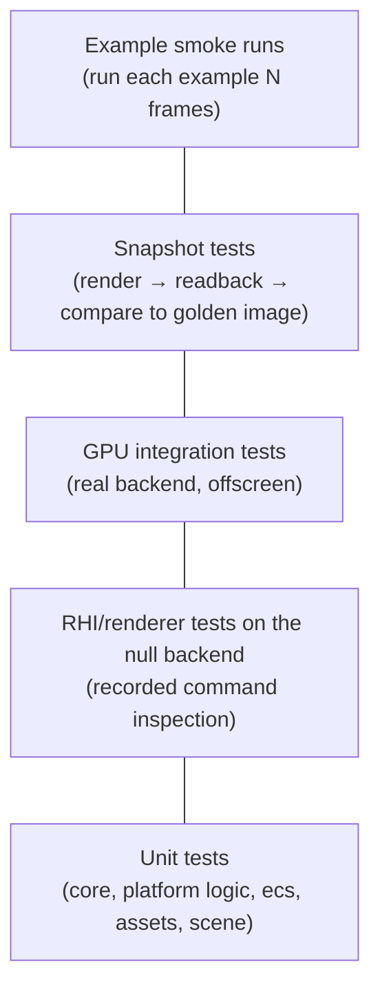

# Testing strategy

Tests are how a solo developer keeps moving fast without breaking things. Every layer has a test style that matches it. Framework: Catch2 v3 ([ADR-0012](../adr/0012-testing-framework-catch2.md)).

## Test pyramid

Most tests are at the bottom: fast, deterministic, no GPU, run on every build. The upper levels catch integration and visual regressions.

## Unit tests

- Location: `engine/<module>/tests/`, one executable per module (`teserra_<module>_tests`), registered with `catch_discover_tests`.
- Naming: `TEST_CASE("HandlePool: stale handle is rejected", "[core][handle]")`.
- Must run in milliseconds, without files outside the test's own data, without a window or GPU, and without sleeping. Time is injected via a manual `Clock`.
- Assertions: engine assertions are routed to the test framework via `setAssertHandler`, so a triggered `TESERRA_ASSERT` fails the test with the message (and "expect assert" tests are possible: `REQUIRE_ASSERTS(expr)` helper).
- **Randomized model tests** for data structures: the ECS and `HandlePool` are tested by applying random operation sequences to both the real implementation and a naive reference (e.g. `std::map`) and comparing state after every step. Seeds are printed on failure.

## RHI and renderer tests

- **Null backend** (`teserra_rhi_null`): renderer tests build a `FramePacket` by hand, render one frame, and assert on the recorded stream ("2 batches, 1 pipeline switch, bind group 2 changes once"). RHI validation tests assert that invalid usage is detected (draw outside a render pass, mismatched pipeline/target formats, stale handles).
- **Command stream tests**: record → serialize → compare to expected sequence.
- **Allocation tests**: a steady-state frame performs zero heap allocations ([memory and performance](../architecture/memory-and-performance.md#verifying-the-allocation-rule)).

## GPU integration tests

- Location: `tests/gpu/`. Use the real OpenGL backend with a hidden window (or the headless mechanism chosen by the spike), render offscreen, read back.
- Locally they run with the normal test command if a GPU is available; they skip (not fail) with a clear message when no suitable context can be created, unless `TESERRA_REQUIRE_GPU_TESTS=1` is set (CI sets it on GPU jobs).
- **Headless GPU testing in CI** is decided by a time-boxed spike (candidates: Mesa llvmpipe for Windows, i.e. a software OpenGL 4.5 implementation shipped as `opengl32.dll` next to the test executable; or a Linux runner with Mesa llvmpipe once the GL backend builds on Linux). Until then, GPU tests run locally before merging rendering PRs (PR checklist item).
- Key GPU tests: orientation and winding tests ([ADR-0024](../adr/0024-coordinate-conventions.md)), clear/triangle/textured quad, bind group remapping, frames-in-flight ring buffer correctness, swapchain resize.

## Snapshot tests

- Render a scene to an offscreen target at a fixed resolution, read back RGBA8, compare with `tests/golden/<test>.png`.
- Comparison: per-channel tolerance (default 2/255) and maximum differing pixel ratio (default 0.1%), configurable per test because software and hardware rasterizers differ slightly. Prefer scenes that avoid driver-dependent filtering (nearest sampling, axis-aligned quads).
- On failure, the actual image and a diff image are written to `tests/golden/_actual/` and `_diff/` (git-ignored) and uploaded as CI artifacts.
- Updating goldens: run the test binary with `--update-goldens`, review the image change in the PR (GitHub renders PNG diffs). A golden update without an explanation in the PR description is rejected.

## Example smoke runs

Every example accepts `--frames N --hidden-window`; CI (GPU job) runs each for 120 frames and fails on non-zero exit, assertion or `Error`-level log. This keeps examples from rotting.

## Benchmarks

Separate from tests, see [benchmarking policy](../architecture/memory-and-performance.md#benchmarking-policy).

## What every PR needs

| Change | Required tests |
|---|---|
| Bug fix | Regression test that fails before the fix |
| New core/ecs/assets/scene logic | Unit tests for normal and error paths |
| New RHI feature | Validation tests (null backend) + a GPU test or example exercising it |
| Renderer feature | Null-backend command test; snapshot test once the snapshot harness exists |
| Public API change | Example or test using the new API; dream code in [public-api.md](../architecture/public-api.md) updated if affected |
| Performance change | Benchmark before/after (not a test) |
