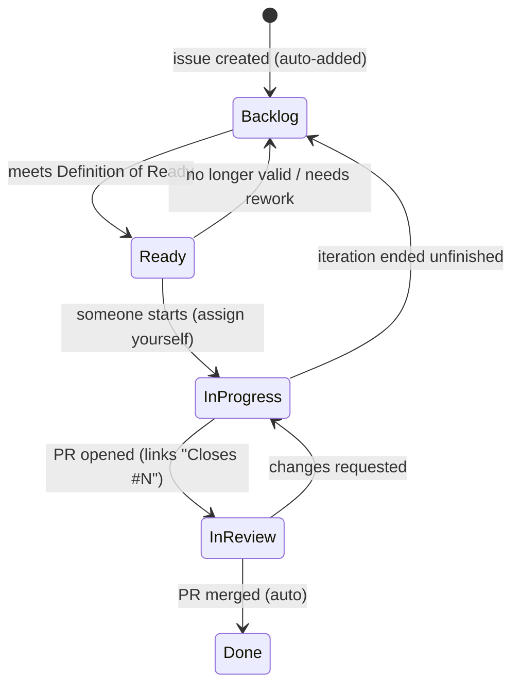
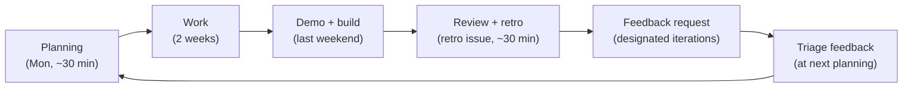

# Development process

Teserra is developed in **two-week iterations with one headline feature each** ([ADR-0022](../adr/0022-iteration-and-process-model.md)). The process is agile (ship small, get feedback, adjust) and disciplined (agile never relaxes the quality rules below).

The backlog, roadmap and iterations live in the **[Teserra GitHub Project](https://github.com/users/fyernald/projects/3)** and in GitHub Issues. There are no backlog files in this repository.

## Roles

| Role | Who | Responsibilities |
|---|---|---|
| Maintainer | @fyernald | Plans iterations, reviews and merges PRs, writes ADRs, publishes builds, triages feedback |
| Contributor | Anyone | Picks `Ready` issues (see [CONTRIBUTING](../../CONTRIBUTING.md)), opens PRs, proposes RFCs |
| Tester | Anyone | Runs published builds, answers feedback requests |

## Capacity and sizing

- Available time: 5-10 h/week → **10-20 h per iteration**. Committed work is capped at **16 h** (≈20% buffer for surprises, reviews, bugs).
- Issues are estimated in hours in the `Estimate (h)` field. Preferred size **1-6 h**; anything larger is split before it is `Ready`.
- Estimates include tests and docs. They do not include the iteration review/retro (its own 1 h issue).
- **Tech debt budget:** most iterations from iteration 6 onward schedule a time-boxed 1 h *Tech debt & cleanup* issue inside the 16 h, plus concrete `type:refactor` items when they exist (e.g. removing a temporary code path). Iterations that cannot fit one (feedback or spike-heavy iterations) take cleanup from the buffer. Over a release, debt work should average ~10% of completed hours; the retro checks this.
- **Velocity** = sum of `Estimate (h)` of issues closed in an iteration ("Done / velocity" view). After three iterations, plan with the average of the last three, still capped at 16 h.

## The GitHub Project

| Field | Values | Use |
|---|---|---|
| Status | Backlog, Ready, In progress, In review, Done | Workflow state (below) |
| Iteration | 2-week iterations starting Mondays | Which iteration an item is committed to; empty = not scheduled |
| Estimate (h) | number | Planning and velocity |
| Area | core, platform, rhi, renderer, ecs, assets, build, docs, editor | Ownership and filtering |
| Work type | feature, task, bug, refactor, research/spike, RFC | Kind of work (mirrors the `type:*` label; GitHub reserves the field name "Type") |
| Priority | P0, P1, P2, P3 | See below |
| Target version | v0.1, v0.2, v0.3, v1.0, v2.0, v3.0 | Release the item belongs to |
| Readiness | none, 3D, Vulkan, Linux | Which future-proofing concern the item carries |

Views: **Backlog** (unscheduled/future items by priority), **Current iteration** (board by Status), **Roadmap** (timeline by Iteration, epics only), **By area** (table grouped by Area), **Done / velocity** (closed items grouped by Iteration with estimate sums).

### Status flow



- **WIP limit:** at most 2 items `In progress` per person.
- Unfinished items at the end of an iteration go back to `Backlog` with the Iteration field cleared (or moved to the next iteration during planning). **Iterations are never extended.**

### Priorities

| Priority | Meaning |
|---|---|
| P0 | Blocks the current headline feature, breaks `main`, or is a security issue. Preempts everything. |
| P1 | Needed for the current or next iteration's headline feature or for the target release. |
| P2 | Valuable, planned for the target version, not urgent. |
| P3 | Nice to have / idea; may be closed if it stays untouched for two minor versions. |

## Iteration cycle



### Planning checklist (start of iteration)

1. Close the previous iteration's retro issue; read its "what to change" items.
2. Triage new issues and feedback (`needs-triage`, `feedback` labels): assign Type, Area, Priority, Target version, Estimate, or close with a reason.
3. Confirm the **headline feature** (one epic). Check its exit criterion is demoable.
4. Pull `Ready` sub-issues of the epic into the iteration, then supporting tasks, then 1-2 h of tech debt, until the sum reaches **≤ 16 h**.
5. Verify every committed issue meets the Definition of Ready. Anything touching a public interface, the RHI or the ECS has a design note.
6. Set the Iteration field; move items to `Ready`.

### During the iteration

- Work top-down by priority. Open a draft PR early for anything larger than 3 h.
- If an item grows beyond its estimate by 50%, stop and split it (record the remainder as a new issue) instead of silently continuing.
- New ideas go into new issues (`needs-triage`), not into the current PR.

### End of iteration

1. Demo on `main`: the epic's exit criterion runs from a clean build.
2. Tag a pre-release when meaningful ([release process](release-process.md)).
3. Fill in the iteration's **retro issue** (template "Iteration review & retrospective").
4. For feedback iterations: open a **feedback request** issue (template) with the build link and questions.
5. Close the epic if its acceptance criteria are met; otherwise record what remains as new issues.

## Definition of Ready

An issue is `Ready` when:

- [ ] Context ("why") and scope are written; **non-goals** are explicit.
- [ ] Acceptance criteria are a checklist of testable statements.
- [ ] Estimate is set and ≤ 6 h.
- [ ] Dependencies are resolved or scheduled earlier in the same iteration.
- [ ] Relevant docs/ADRs are linked; the needed decision exists (or the issue is a spike/RFC to make it).
- [ ] If it touches a public interface, the RHI or the ECS: a **design note** exists (in the issue or an ADR), see below.
- [ ] Future-proofing note present when relevant (3D / Vulkan / Linux readiness).
- [ ] Test approach is described.
- [ ] Fields set: Type, Area, Priority, Target version, Estimate.

## Definition of Done

An issue is `Done` when:

- [ ] Code merged to `main` through a reviewed PR (self-review against the PR checklist counts for the maintainer).
- [ ] CI is green: Windows build, tests, format check, layer/leak checks; no new warnings.
- [ ] `clang-format` clean and `clang-tidy` clean for changed files.
- [ ] Tests added/updated as required by the [testing strategy](../guides/testing-strategy.md#what-every-pr-needs); GPU tests run locally for rendering changes if CI cannot run them yet.
- [ ] No layer violations, no backend/platform leaks.
- [ ] Docs updated: architecture page and/or ADR when design changed; public API `///` comments; CHANGELOG entry for user-visible changes.
- [ ] All acceptance criteria checked; the demo/example (if any) works from a clean build.
- [ ] Follow-up work captured as issues (no orphan `TODO`s).

## Design notes

**Required** before coding when an issue changes or adds a public interface, anything in `engine/rhi/`, or anything in `engine/ecs/`. Recommended for everything over 4 h.

Short is fine (10-30 lines), in the issue body or a comment:

```markdown
### Design note
- Problem / goal:
- Proposed interface (signatures or sketch):
- Alternatives considered (and why not):
- Impact on other layers / backends (GL now, Vulkan later):
- 3D / Vulkan / Linux readiness:
- Test plan:
```

If the note changes an existing ADR's decision or the pattern catalog, write an ADR (or open an RFC issue first if it needs discussion).

## Spikes

- Type `research/spike`, always **time-boxed** (estimate = time box, typically 2-4 h).
- Output: a written result in the issue (findings, recommendation, numbers) and, when a decision follows, an ADR or ADR update.
- Spike code lives on a `spike/<topic>` branch and is **never merged**. Production code is written afterwards under normal rules.
- When the time box ends, stop and write up what is known, even if the answer is "unclear: next spike needed".

## Feedback loop

Builds for outside testers are published at designated iterations (see the epic of each iteration for specifics):

| Iteration | Build | Audience | Key questions |
|---|---|---|---|
| 5: First triangle through the RHI (**hardware check**) | `rhi_triangle.exe` zip | Anyone with a Windows PC | Does a colored triangle appear? GPU, driver, OS? Any error dialog or log errors? |
| 8: Sprite batcher and 2D camera (**first public feedback round**) | Sprite stress demo zip | Players and developers | FPS at 1k/10k sprites (on-screen counter), visual glitches (is the top-left marker top-left?), camera pan/zoom feel, hardware |
| 10: Scene, transforms and systems (**API preview**) | Source + `scene_sprites` example | C++ developers | Is the scene/ECS API understandable from the example? What would you rename? What was missing to build a small scene? |
| 14: Demo game | Demo game zip + source | Players and developers | Did it run? Crashes, input feel, performance; developers: does the game source read well? |
| 16: v0.1 release | Release + getting-started guide | Developers | Time from clone to first sprite on screen; build problems; docs gaps |

Procedure:

1. **Publish** the build as a GitHub pre-release (zip with executable, assets, `THIRD_PARTY_NOTICES.md`, a `README.txt` with run instructions and the feedback link).
2. **Ask** with a *Feedback request* issue (template) listing 3-6 specific questions, the build link, and a deadline (default: 10 days, i.e. before the next planning). Share the link in relevant communities.
3. **Collect** answers as comments on the feedback request (or a linked Discussion if enabled). Testers can also open bugs with the Bug template.
4. **Triage** at the next planning: each actionable point becomes an issue labeled `feedback` (bug, task or feature) or is answered and closed with a reason. Summarize the outcome in a final comment and close the feedback request.
5. **Report back** in the next iteration's retro: what was learned and what changed because of it.

## Review and retrospective

At the end of every iteration, fill in the iteration's retro issue (created from the *Iteration review & retrospective* template and pre-scheduled in each iteration). Keep it short: 15-30 minutes.

```markdown
## What shipped
- Headline feature: <epic link> - done / partially (what remains)
- Other merged work:
- Build / tag:
## Numbers
- Committed: __ h · Completed: __ h · Carry-over: __ h
## What we learned
-
## Feedback received
- (link feedback request, top 3 points)
## What to change next iteration
- (1-3 concrete process or technical changes)
```

## Sustainable pace

- One developer, limited hours: protect the buffer. Do not "borrow" from the next iteration.
- Exam periods, holidays or low-energy weeks: plan a **light iteration** (≤ 8 h, no headline feature, debt and docs only) or a **break** in the Iteration field. Both are normal and are recorded in the retro, not hidden.
- Celebrate demos: every iteration ends with something that runs.
